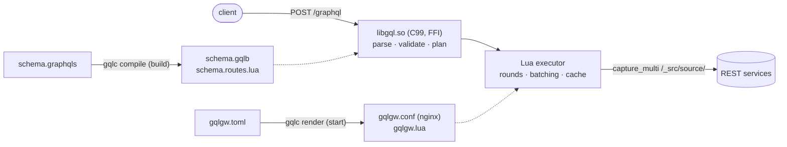

# gqlgw — SDL-first GraphQL gateway for OpenResty

[](https://github.com/abusi/gqlgw/actions/workflows/ci.yml)
[](https://abusi.github.io/gqlgw/)
[](LICENSE)

gqlgw serves a GraphQL API described in SDL, whose fields are resolved by REST services behind
nginx. N+1 patterns are removed by **batching** (dataloader style, in rounds) and by a
**three-level resource cache** (per-worker LRU, `lua_shared_dict`, memcached).

**Documentation: <https://abusi.github.io/gqlgw/>**



```graphql
type Query {
  posts(limit: Int = 20): [Post!]! @fetch(source: "posts", path: "/posts?limit={args.limit}")
}

type Post {
  title: String!
  authorId: ID! @from(key: "author_id")
  author: User
    @fetch(source: "users", path: "/users/{parent.authorId}")
    @batch(path: "/users?ids={keys}", match: "id", max: 50)
}

type User @cache(ttl: 300) { id: ID! name: String! }
```

`{ posts { title author { name } } }` makes two upstream calls: the posts, then all their authors
in one batch. The next time, the authors come from the cache.

## Quick start (Docker)

```bash
make image                   # base image gqlgw:<version> and gqlgw:latest (local only)
cd examples/docker
docker compose up --build    # example gateway + memcached + mock backend
curl -s localhost:8080/graphql -H 'Content-Type: application/json' \
     -d '{"query":"{ posts(limit: 3) { title author { name } } }"}'
curl -s localhost:8191/gqlgw_metrics
```

A gateway is an image built `FROM gqlgw` with your schema and your configuration:

```dockerfile
FROM gqlgw:0.2.0
COPY schema.graphqls gqlgw.toml /etc/gqlgw/
RUN gqlc compile -c /etc/gqlgw/gqlgw.toml /etc/gqlgw/schema.graphqls
```

```bash
docker run --read-only --tmpfs /tmp -p 8080:8080 -p 8191:8191 \
    -e USERS_URL=http://users:8080 -e POSTS_URL=http://posts:8080 my-gateway
```

- **At build time**, `gqlc compile -c` compiles the SDL and checks the configuration. An invalid
  schema, or a `@fetch(source:)` without its `[sources.x]`, fails `docker build`.
- **At start**, the entrypoint runs `gqlc render` (environment interpolation, value checks),
  then `openresty -t` (which loads the schema), then `openresty`. A missing variable stops the
  container with a clear message.

Without Docker: `make && sudo make install`, then `gqlc compile`, `gqlc render`, and
`include gqlgw.conf;` in your `http {}` block
([guide](https://abusi.github.io/gqlgw/operations/install/)).

## Documentation

| | |
|---|---|
| [How it works](https://abusi.github.io/gqlgw/how-it-works/) | architecture, build pipeline, life of a request, rounds and batching, cache |
| [Examples](https://abusi.github.io/gqlgw/examples/) | full server, locations only, batch vs no batch, auth forwarding, mutations, unions |
| [Reference](https://abusi.github.io/gqlgw/reference/directives/) | SDL directives, `gqlgw.toml`, `gqlc`, generated nginx configuration, HTTP, metrics, Lua API |

Design notes and milestones: [PLAN.md](PLAN.md). Measurements: [bench/RESULTS.md](bench/RESULTS.md).

## Development

```bash
make deps        # OpenResty 1.31.1.1, Test::Nginx, graphql-js, toml-test (in .deps/, no sudo)
make             # build/libgql.so + build/gqlc
make test        # C (ASan/UBSan), toml-test, config, graphql-js oracle, Test::Nginx
make docker-test # image + example gateways + memcached + mock
make fuzz        # libFuzzer (FUZZ_TIME=60 per target)
make bench       # wrk: naive vs @batch vs @batch + @cache
```

Pull requests run the tests, the fuzzers, the Docker test and a strict documentation build
([CI](.github/workflows/ci.yml)). The documentation site is published from `main`
([docs.yml](.github/workflows/docs.yml)).

## License

BSD-2-Clause, see [LICENSE](LICENSE).
