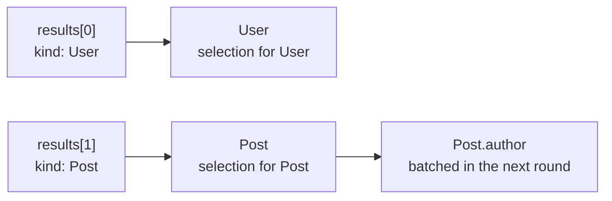

# Unions and interfaces

For a field whose type is a union or an interface, the gateway must know the concrete type of
each JSON object. The object says it with a **discriminator** property: `__typename` by default,
or the key named by `@discriminator` on the union or interface.

```graphql
--8<-- "examples/docker/schema.graphqls:17:18"

--8<-- "examples/docker/schema.graphqls:51:51"
```

The search service answers:

```json
{"results": [
  {"kind": "User", "id": "1", "name": "User 1"},
  {"kind": "Post", "id": "2", "title": "Post 2", "author_id": "3", "tags": []}
]}
```

`select: "results"` picks the array, and each item is typed by its `kind`:



```graphql
{
  search(q: "x") {
    __typename
    ... on Node { id }
    ... on User { name }
    ... on Post { title author { name } }
  }
}
```

The plan holds one selection per possible type (`User`, `Post`), with the fragments that apply to
it already merged. Execution only picks the selection that matches the discriminator. Fields of
the concrete type can carry their own `@fetch`, as `Post.author` does.

## When the discriminator is wrong

The mock used by the example adds a third result, `{"kind": "Robot"}`, to show the failure:

```json
{"errors":[{"message":"Abstract type \"SearchResult\" must resolve to an Object type at runtime for field \"Query.search\": the value has no valid \"kind\" (got \"Robot\").","locations":[{"line":2,"column":3}],"path":["search",2]}],"data":null}
```

The item becomes a field error. Because the field is `[SearchResult!]!`, the `null` propagates
up to `data`. With `[SearchResult]` the other two results would still be returned.

## Rules

- `@discriminator(key:)` goes on the union or the interface. Without it, the key is `__typename`.
- The value must be the name of an object type that belongs to the union or implements the
  interface.
- `__typename` in a query always returns the GraphQL type name, even when the discriminator key
  is something else.
