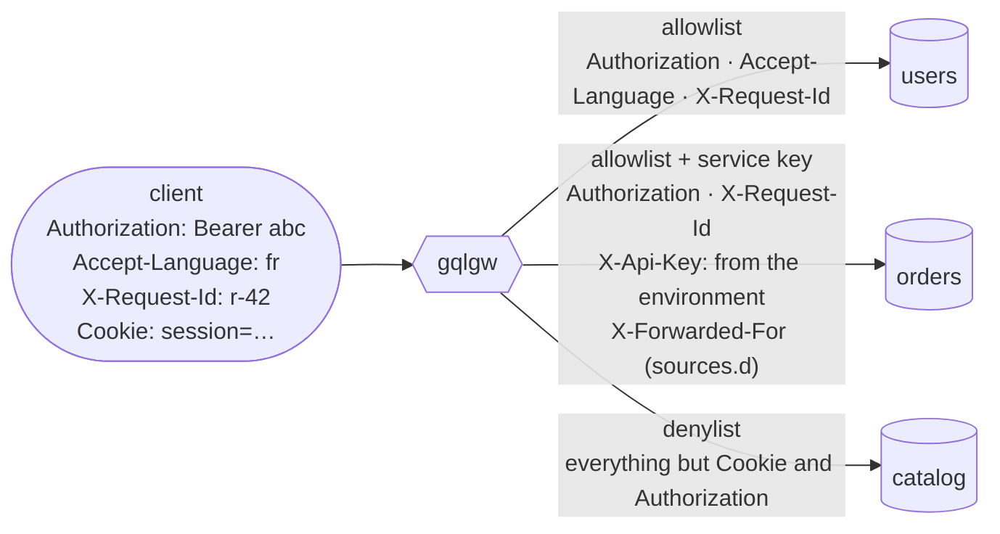
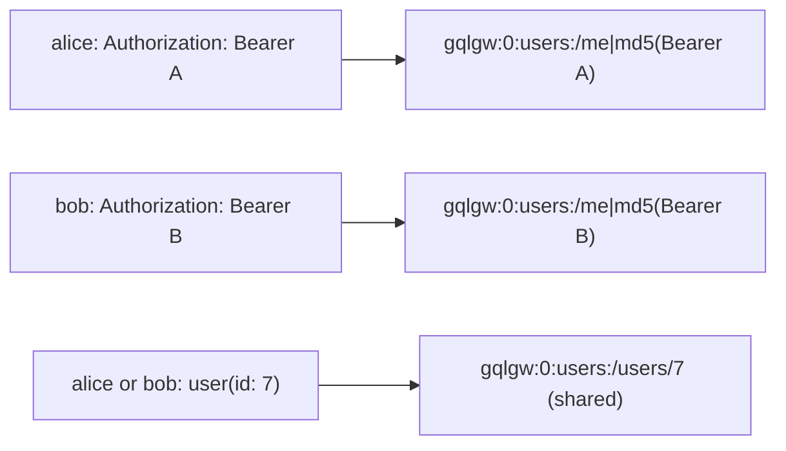

# Auth context forwarding

The gateway does not authenticate anyone. It **forwards the caller's context** to the services,
which decide, and it keeps per-user responses apart in the cache. This example has three
services with three header policies.



=== "gqlgw.toml"

    ```toml
    --8<-- "examples/auth/gqlgw.toml"
    ```

=== "schema.graphqls"

    ```graphql
    --8<-- "examples/auth/schema.graphqls"
    ```

=== "sources.d/orders/forwarded.conf"

    ```nginx
    --8<-- "examples/auth/sources.d/orders/forwarded.conf"
    ```

```bash
gqlc compile -c gqlgw.toml schema.graphqls
ORDERS_API_KEY=… gqlc render -c gqlgw.toml -o /etc/nginx/gqlgw
```

## Three header policies

=== "Allowlist (default)"

    `forward_headers` lists the client headers that reach the service. Nothing else does: no
    cookies, no internal headers, no `X-Forwarded-*` unless you add them. The default is
    `["Authorization"]`.

    ```nginx
    location /_src/users/ {
        # ...
        proxy_pass_request_headers off;
        proxy_set_header Authorization $http_authorization;
        proxy_set_header Accept-Language $http_accept_language;
        proxy_set_header X-Request-Id $http_x_request_id;
        proxy_set_header Accept "application/json";
        # ...
    }
    ```

=== "Allowlist + set_headers"

    `set_headers` adds fixed headers, after the forwarded ones: a client cannot override them.
    Values are literal (a `$` stays a `$`) and can come from the environment at render time.

    ```nginx
    location /_src/orders/ {
        # ...
        proxy_pass_request_headers off;
        proxy_set_header Authorization $http_authorization;
        proxy_set_header X-Request-Id $http_x_request_id;
        proxy_set_header Accept "application/json";
        proxy_set_header X-Api-Key "…value of ORDERS_API_KEY…";
        # ...
        include "/etc/gqlgw/sources.d/orders/*.conf";   # X-Forwarded-For, X-Real-IP
        proxy_pass "https://gqlgw_orders$gqlgw_path";
    }
    ```

=== "Denylist"

    `drop_headers` forwards every client header except the listed ones. Use it for services that
    read many custom headers. It is exclusive with `forward_headers`.

    ```nginx
    location /_src/catalog/ {
        # ...
        proxy_set_header Cookie "";
        proxy_set_header Authorization "";
        proxy_set_header Accept "application/json";
        # ...
    }
    ```

Some headers are managed by the gateway and cannot be listed: `Host`, `Connection`,
`Content-Length`, `Content-Type`, `Transfer-Encoding`, `Accept-Encoding`, `TE`, `Keep-Alive`,
`Upgrade`, `Expect`, `Proxy-Connection`. `Accept` defaults to `application/json` unless you
forward it or set it.

## Per-user responses and the cache

The cache key is the upstream request. `GET /me` is the same request for every caller, so it
must not be cached as a shared resource. `scope: "PRIVATE"` adds a hash of the `private_header`
value (default `Authorization`) to the key:



| Field | Cache | Why |
|---|---|---|
| `Query.me` | `@cache(ttl: 30, scope: "PRIVATE")` | the response depends on the caller |
| `Query.user` | `User @cache(ttl: 300)`, shared | the same user for everyone |
| `User.orders` | `PRIVATE`, 10 s | a user's orders, visible only with their token |
| `Order.items` | none on the field, `Product @cache(ttl: 600)` | the catalog is public |

!!! danger "A shared entry is served to every caller"
    If a service filters its answer by caller (per-user fields, permissions, tenants), the route
    must be `PRIVATE`, or not cached at all. When in doubt, leave `@cache` out.

## Adding what gqlgw.toml cannot express

Files in `sources.d/<source>/*.conf`, next to `gqlgw.toml`, are included inside the location of
that source. Any `proxy_*` directive works. For instance, client certificates for an mTLS
service:

```nginx title="sources.d/orders/mtls.conf"
proxy_ssl_certificate     /etc/gqlgw/certs/gateway.pem;
proxy_ssl_certificate_key /etc/gqlgw/certs/gateway.key;
```

In the Docker image, the directory is `/etc/gqlgw/sources.d/` (`COPY sources.d/ /etc/gqlgw/sources.d/`).

## Checking what a service receives

Point a source at an echo endpoint and look at the request. The test suite does exactly this
(`t/006-config.t`): with the allowlist, the backend receives `Authorization` and nothing else
from the client; with the denylist, it receives everything but the listed headers.
