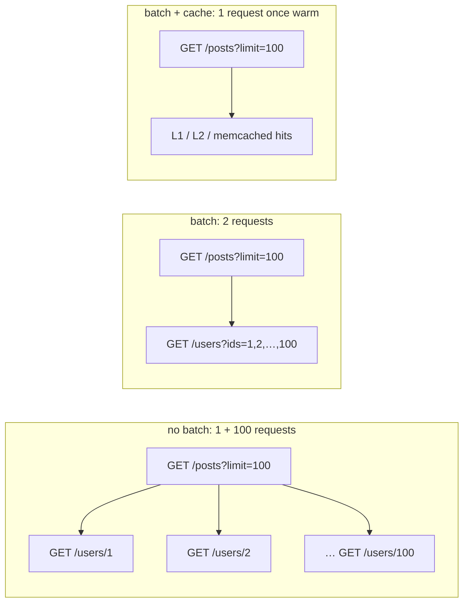

# Batch vs no batch

The same relation (`Post.author`) declared three ways, as in the benchmark schema
(`bench/schema.graphqls`): 100 posts written by 100 distinct authors.

=== "No batch"

    ```graphql
    type Post {
      authorId: ID! @from(key: "author_id")
      author: User @fetch(source: "users", path: "/users/{parent.authorId}")
    }
    ```

    One request per **distinct** author. Identical requests of a round are merged, so 100 posts by
    10 authors cost 10 requests, but 100 authors cost 100.

=== "Batch"

    ```graphql
    type Post {
      authorId: ID! @from(key: "author_id")
      author: User
        @fetch(source: "users", path: "/users/{parent.authorId}")
        @batch(path: "/users?ids={keys}", match: "id", max: 100)
    }
    ```

    One request per round for all the authors (per chunk of `max` keys). The service must
    answer `GET /users?ids=1,2,3` with a JSON array of users that carry an `id`.

=== "Batch + cache"

    ```graphql
    type Post {
      authorId: ID! @from(key: "author_id")
      author: User
        @fetch(source: "users", path: "/users/{parent.authorId}")
        @batch(path: "/users?ids={keys}", match: "id", max: 100)
        @cache(ttl: 300)
    }
    ```

    Only the authors missing from the cache are batched. Each one is cached under the key of its
    single fetch (`users:/users/42`), which `user(id: 42)` would also hit.



## Measured

`{ posts(limit: 100) { id title author { name } } }`, a backend that takes 2 ms per request,
wrk with 16 connections, 2 workers:

| Variant | Subrequests per query | req/s | Latency avg | p99 |
|---|---|---|---|---|
| no batch | 101 | 426 | 48.0 ms | 577 ms |
| batch | 2 | 1468 | 10.9 ms | 15.2 ms |
| batch + cache | 2 the first time, then 1 | 1852 | 8.6 ms | 12.8 ms |

## Check it yourself

Turn on the debug headers (`[gateway] debug_headers = true`) and look at the response headers:

```text
# no batch                    # batch                       # batch + cache, second query
X-GQL-Rounds: 2               X-GQL-Rounds: 2               X-GQL-Rounds: 2
X-GQL-Subrequests: 101        X-GQL-Subrequests: 2          X-GQL-Subrequests: 1
X-GQL-Batches: 0              X-GQL-Batches: 1              X-GQL-Batches: 0
```

In production, the metrics give the same picture per field:

```promql
# batched requests per second, and the mean batch size
rate(gqlgw_batches_total{coordinate="Post.author"}[5m])
rate(gqlgw_batch_size_sum[5m]) / rate(gqlgw_batch_size_count[5m])
```

## When not to batch

- The service has no "many" endpoint: keep the single fetch. Deduplication still applies.
- The key is not a scalar field of the parent JSON, or the path needs two parent values:
  `@batch` needs exactly one `{parent.*}` in the `@fetch` path.
- The "many" endpoint is much slower per item than the single one: `max` bounds the chunk size.
