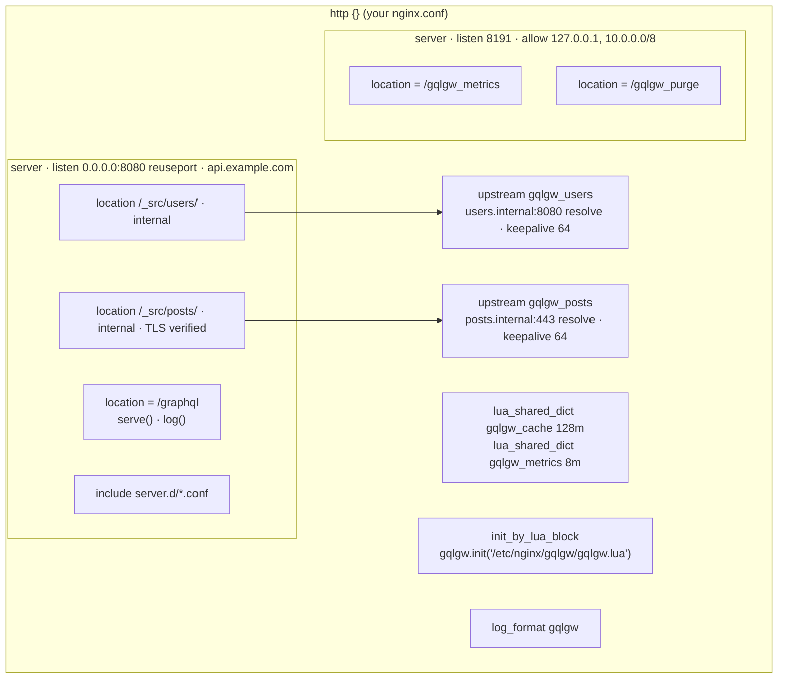

# Full server

The default mode: `gqlc render` writes **one file**, `gqlgw.conf`, which you include in the
`http {}` block of any nginx/OpenResty configuration. It brings its own `server {}` for GraphQL
and a second one for the admin endpoints.

```toml title="examples/full/gqlgw.toml"
--8<-- "examples/full/gqlgw.toml"
```

```bash
cd /etc/gqlgw                                        # gqlgw.toml + schema.graphqls
gqlc compile -c gqlgw.toml schema.graphqls           # schema.gqlb, schema.routes.lua
gqlc render  -c gqlgw.toml -o /etc/nginx/gqlgw       # gqlgw.conf, gqlgw.lua
```

```nginx title="nginx.conf"
http {
    # ... your existing configuration ...
    include /etc/nginx/gqlgw/gqlgw.conf;
}
```

## What the include contains



Excerpt of the generated `gqlgw.conf` (the `/_src/posts/` location):

```nginx
location /_src/posts/ {
    internal;                                   # unreachable from outside
    proxy_http_version 1.1;
    proxy_set_header Connection "";             # keepalive to the upstream
    proxy_set_header Host "posts.internal";     # from the URL, not "gqlgw_posts"
    proxy_set_header Accept-Encoding "";        # the gateway decodes JSON
    proxy_set_header Content-Type $gqlgw_ctype; # set only when there is a body
    proxy_pass_request_headers off;             # allowlist:
    proxy_set_header Authorization $http_authorization;
    proxy_set_header Accept-Language $http_accept_language;
    proxy_set_header Accept "application/json";
    more_set_headers "X-Gqlgw-Upstream-Time: $upstream_header_time";   # metrics
    proxy_connect_timeout 1s;
    proxy_send_timeout 5s;
    proxy_read_timeout 5s;
    proxy_ssl_server_name on;                   # https: SNI + verification
    proxy_ssl_name "posts.internal";
    proxy_ssl_verify on;
    proxy_ssl_verify_depth 4;
    proxy_ssl_trusted_certificate "/etc/ssl/certs/ca-certificates.crt";
    include "/etc/gqlgw/sources.d/posts/*.conf";   # your additions, if any
    proxy_pass "https://gqlgw_posts$gqlgw_path";   # path rendered by the gateway
}
```

Every line is explained in [Generated nginx configuration](../reference/nginx.md).

## Things to note

- `listen`, `server_name`, the metrics `port` and `allow` are passed to nginx as written, so
  `listen = "0.0.0.0:8443 ssl"` works. Put the certificates in `server.d/*.conf`, next to
  `gqlgw.toml`.
- `resolver = "auto"` copies the nameservers of `/etc/resolv.conf` when rendering. Upstreams
  named by DNS are re-resolved at runtime (`server ... resolve`), every `resolver_valid`.
- `access_log` takes a path, or `"off"`. The `gqlgw` format adds `rounds=`, `sub=` and `cache=` to
  the usual fields.
- Two gateways sharing the same memcached share the L3 cache, and a purge on one is seen by the
  other within `gen_ttl`.
