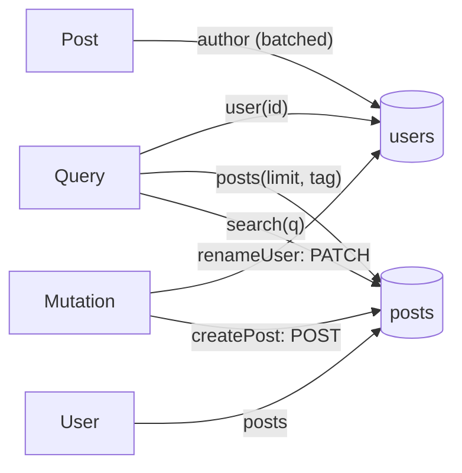

# Examples

Every configuration on these pages is a real file of the repository, under
[`examples/`](https://github.com/abusi/gqlgw/tree/main/examples). `make test-config` compiles each
one with its schema, renders it and runs `openresty -t` on the result, so the examples cannot drift
from the code.

| Example | Shows | Files |
|---|---|---|
| [Full server](full.md) | default mode: gqlgw brings its own `server {}`, memcached, metrics, purge | `examples/full/` |
| [Locations only](locations-only.md) | gqlgw inside an existing `server {}` (its TLS, its domain) | `examples/locations-only/` |
| [Batch vs no batch](batching.md) | N+1, deduplication, `@batch`, `@batch` + `@cache` | `bench/schema.graphqls` |
| [Auth context forwarding](auth.md) | header allowlist and denylist, service keys, `PRIVATE` cache, `sources.d` | `examples/auth/` |
| [Mutations](mutations.md) | `POST`/`PATCH` with JSON bodies, serial execution | `examples/docker/` |
| [Unions and interfaces](abstract-types.md) | `@discriminator`, runtime types | `examples/docker/` |

The Docker example (`examples/docker/`) is the one of [Getting started](../getting-started.md).
It also serves as the integration test of the image (`make docker-test`).

Most examples use the blog schema of `examples/docker/schema.graphqls`: two REST services,
`users` and `posts`.

