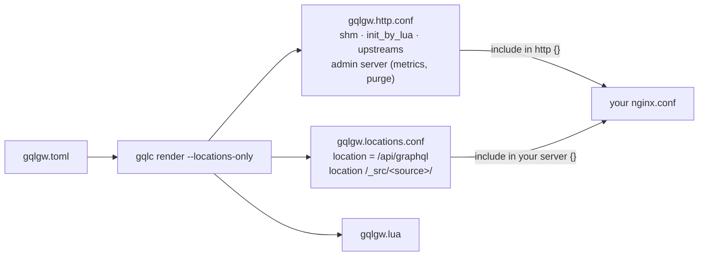

# Locations only

When the GraphQL endpoint must live in a `server {}` you already have (same domain, same TLS
certificate, next to other locations), render with `--locations-only`. You get two files instead
of one.



=== "gqlgw.toml"

    ```toml
    --8<-- "examples/locations-only/gqlgw.toml"
    ```

=== "your nginx.conf"

    ```nginx
    --8<-- "examples/locations-only/nginx.conf"
    ```

```bash
gqlc compile -c gqlgw.toml schema.graphqls
gqlc render  -c gqlgw.toml -o /etc/nginx/gqlgw --locations-only
nginx -t && nginx -s reload
```

## What goes where

| File | Contents | Include in |
|---|---|---|
| `gqlgw.http.conf` | `lua_shared_dict`, `init_by_lua_block`, `log_format` (with `access_log`), one `upstream gqlgw_<source>` per source, the admin `server {}` | `http {}` |
| `gqlgw.locations.conf` | `location = /api/graphql` and the `internal` locations `/_src/<source>/` | your `server {}` |
| `gqlgw.lua` | runtime options read by `gqlgw.init()` | (nothing: loaded by the init) |

The generated GraphQL location:

```nginx
location = /api/graphql {
    set $gqlgw_path "";        # variables used by the /_src/ locations and the access log
    set $gqlgw_ctype "";
    set $gql_rounds "-";
    set $gql_subrequests "-";
    set $gql_cache "-";
    client_max_body_size 1m;   # [gateway] max_body
    client_body_buffer_size 1m;
    content_by_lua_block { require("gqlgw").serve() }
    log_by_lua_block { require("gqlgw").log() }
}
```

## Things to note

- `[gateway] listen` and `server_name` are ignored in this mode: the host `server {}` decides.
- The admin server (metrics, purge) stays a separate `server {}` on its own port, in
  `gqlgw.http.conf`. Set `[metrics] enabled = false` and `[purge] enabled = false` to drop it.
- `/_src/` is reserved in the host server: the generated locations are `internal`, so a client
  cannot reach them, but you cannot use that prefix for anything else.
- Only one `init_by_lua` is allowed per `http {}`. If yours exists, set `[nginx] init = false` and
  call `require("gqlgw").init("/etc/nginx/gqlgw/gqlgw.lua")` in it. See
  [Existing nginx / OpenResty](../operations/install.md).
