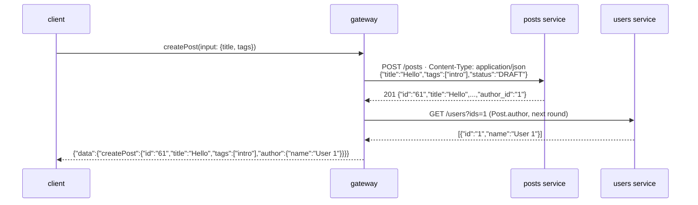

# Mutations

A mutation field is a `@fetch` with a method other than `GET` and, usually, a JSON body built
from the arguments. From the blog schema (`examples/docker/schema.graphqls`):

```graphql
--8<-- "examples/docker/schema.graphqls:21:26"

--8<-- "examples/docker/schema.graphqls:53:58"
```

## Body templates

| Template | Sends |
|---|---|
| `"{\"name\": {args.name}}"` | a literal JSON object with one argument, JSON-encoded: `{"name": "Ada"}` |
| `"{args.input}"` | one argument, as JSON (an input object becomes an object) |
| `"{args}"` | every argument, as a JSON object, in schema order |

An opening brace that is not followed by `args`, `parent` or `keys` is literal, so JSON bodies are
written as they are. The arguments are **coerced first**: defaults are applied, enums and input
objects are checked, and a missing nullable field without a default is left out.

```bash
curl -s localhost:8080/graphql -H 'Content-Type: application/json' -d '{
  "query": "mutation New($in: PostInput!) { createPost(input: $in) { id title tags author { name } } }",
  "variables": {"in": {"title": "Hello", "tags": ["intro"]}}
}'
```



The returned object is resolved like any other: `author` is batched in the next round.
`Content-Type: application/json` is only sent when there is a body.

## Serial execution

The root fields of a mutation run **one after the other**: each one's fetch and whole subtree
complete before the next one starts. A failing field does not stop the next ones:

```graphql
mutation {
  a: renameUser(id: "1", name: "Ada") { name }
  b: renameUser(id: "404", name: "Bob") { name }
}
```

```json
{"data":{"a":{"name":"Ada"},"b":null}}
```

The users service answered `404` to the second `PATCH`, which resolves to `null` (it would be a
field error with any other non-2xx status).

## Rules

- Methods: `GET`, `POST`, `PUT`, `PATCH`, `DELETE`. `body` is not allowed with `GET`.
- `@cache` only applies to `GET` routes. On another method it is ignored, with a compile warning
  (`@cache is ignored for PATCH fetches`); a `@cache` on the returned type is ignored silently.
- Mutations cannot be sent over HTTP `GET` (`405`, `Allow: POST`).
- Mutations are labelled `type="mutation"` in `gqlgw_requests_total`.
- `{args.x}` inside a body re-encodes the value. The keys of an input object may come out in a
  different order (`{args}` keeps the schema order).
