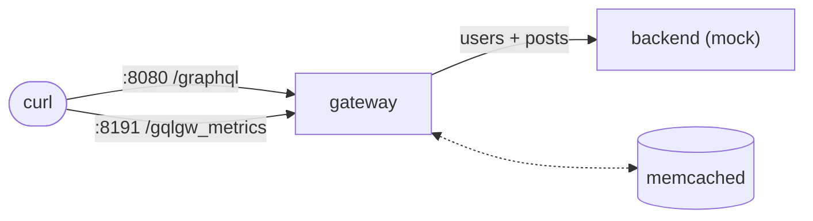
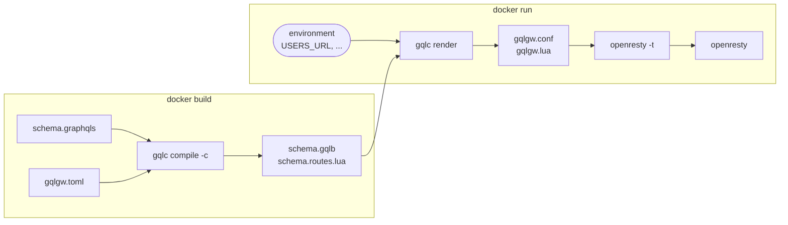

# Getting started

You need Docker (with the `compose` plugin) and a clone of the repository. Nothing is published
on a registry: the base image is built locally.

## 1. Build the base image

```bash
git clone https://github.com/abusi/gqlgw && cd gqlgw
make image            # docker build -t gqlgw:<version> -t gqlgw:latest .
```

The image is built from the official `openresty/openresty:1.31.1.1-resolute`. It adds `gqlc`,
`libgql.so` and the Lua modules. It holds no schema: a gateway is an image built **from** it.

## 2. Run the example gateway

`examples/docker` is a blog API served by two REST services. A mock backend plays both
services, and memcached is the shared cache.

```bash
cd examples/docker
docker compose up --build
```



Query it:

```bash
curl -s localhost:8080/graphql -H 'Content-Type: application/json' \
     -d '{"query":"{ posts(limit: 3) { title author { name } } }"}'
```

```json
{"data":{"posts":[{"title":"Post 1","author":{"name":"User 2"}},{"title":"Post 2","author":{"name":"User 3"}},{"title":"Post 3","author":{"name":"User 4"}}]}}
```

The example turns on the debug headers (`GQLGW_DEBUG_HEADERS=true`), which show what happened
behind the scenes. Add `-i` to the curl command to see them:

```text
X-GQL-Rounds: 2                          # two rounds: posts, then their authors
X-GQL-Subrequests: 2                     # two upstream calls
X-GQL-Batches: 1                         # the three authors in one batch call
X-GQL-Cache: l1=0;l2=0;l3=0;miss=3       # three author lookups, none cached yet
X-GQL-Doc-Cache: miss                    # the query text was parsed and validated
```

Run it again: `X-GQL-Subrequests: 1`. The authors now come from the cache, which is shared
through memcached by every gateway that uses it.

Prometheus metrics are on the admin port:

```bash
curl -s localhost:8191/gqlgw_metrics | grep gqlgw_requests_total
```

## 3. Build your own gateway

A gateway is three files: your schema, your `gqlgw.toml`, and a three-line Dockerfile.

=== "Dockerfile"

    ```dockerfile
    --8<-- "examples/docker/Dockerfile"
    ```

=== "gqlgw.toml"

    ```toml
    --8<-- "examples/docker/gqlgw.toml"
    ```

=== "schema.graphqls"

    ```graphql
    --8<-- "examples/docker/schema.graphqls"
    ```

```bash
docker build -t my-gateway .
docker run --read-only --tmpfs /tmp -p 8080:8080 -p 8191:8191 \
    -e USERS_URL=http://users:8080 -e POSTS_URL=http://posts:8080 my-gateway
```

What happens at each step:



- An invalid schema, or a `@fetch(source: "x")` without a `[sources.x]`, **fails `docker build`**.
- A missing variable (`${USERS_URL:?...}`) **stops the container at start**, with the message
  written in the TOML.

## Next steps

- [Build and deploy pipeline](how-it-works/pipeline.md): what each command checks and produces.
- [SDL directives](reference/directives.md) and [gqlgw.toml](reference/configuration.md): the
  references.
- [Existing nginx / OpenResty](operations/install.md): run gqlgw without Docker.
