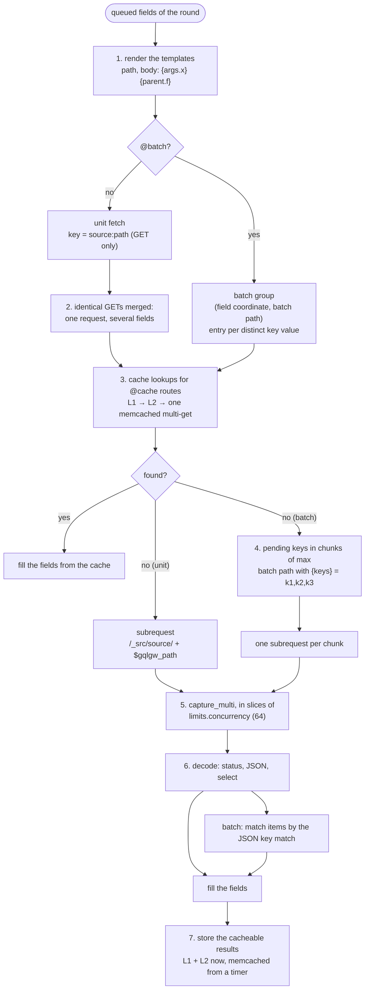
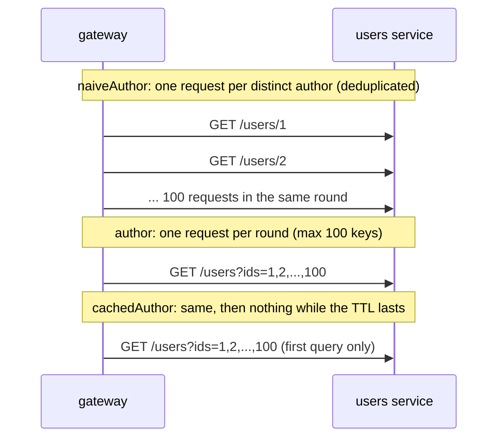

# Rounds and batching

A **round** takes every field waiting for a fetch, whatever its place in the response, and
resolves them together. This page details one round: `gqlgw.fetch.dispatch`.

## Inside a round



1. **Render.** Templates are filled from the coerced arguments and the parent's raw JSON. In a
   path, values are URL-encoded; with `strict_path_args` (the default), a value that contains `/`
   or `\`, or equals `.` or `..`, is refused in a path segment. A body gets JSON-encoded values.
2. **Deduplicate.** Two fields that render the same `GET source:path` share one request, with or
   without `@batch`. A naive `author` on 100 posts by 10 authors makes 10 requests, not 100.
3. **Cache.** Only routes with `@cache` (on the field or on the returned type) are looked up.
   All the lookups of the round are made together: L1 and L2 per key, then **one** memcached
   multi-get for all the misses.
4. **Batch.** The misses of a batch group are joined into `{keys}`, `max` at a time
   (`@batch(max:)`, default 100).
5. **Send.** All the subrequests of the round go out together through `ngx.location.capture_multi`,
   in slices of `limits.concurrency`. The round fails as a whole if it would exceed `limits.fetches`.
6. **Decode.** See the status table below. `select: "data.items"` picks a sub-value.
7. **Store.** Each batch item is cached **under the key of its single fetch**
   (`users:/users/42`), so a later query that fetches user 42 alone hits the same entry.

## N+1, deduplicated, batched

The [benchmark](../project/benchmarks.md) schema has the three variants on one type:

```graphql
--8<-- "bench/schema.graphqls"
```



| Variant | Subrequests per query | req/s | p99 |
|---|---|---|---|
| `naiveAuthor` | 101 | 426 | 577 ms |
| `author` | 2 | 1468 | 15 ms |
| `cachedAuthor` | 2, then 1 | 1852 | 13 ms |

## `@batch` rules

```graphql
author: User
  @fetch(source: "users", path: "/users/{parent.authorId}")      # the single fetch
  @batch(path: "/users?ids={keys}", match: "id", max: 50)        # how to fetch many
```

- The `@fetch` must be a `GET` whose path references **exactly one** `{parent.*}`: its value is
  the key.
- The batch path contains `{keys}` exactly once and no `{parent.*}`. It may use `{args.*}`:
  fields with different arguments go to different groups.
- The response must be a JSON array (or `select` must lead to one). Each item is attached to the
  key found in its `match` property (compared as a string). A key that is absent from the
  response resolves to `null`, and with `@cache` it is cached as a negative entry.
- A parent whose key is `null` resolves to `null` without a request.

## Upstream responses

| Response | Value of the field |
|---|---|
| `2xx` with JSON | the JSON (or its `select` sub-value) |
| `204`, or an empty body | `null` |
| `404` | `null`; with `@cache`, cached for `min(ttl, negative_ttl)` |
| any other status | field error `Upstream "users" returned HTTP 502.` |
| invalid JSON | field error `Upstream "users" returned invalid JSON.` |
| truncated, or over `limits.response_bytes` | field error |
| batch response that is not an array | field error on every key of the chunk |

A field error sets the field to `null` and adds an entry to `errors`. The rest of the response is
still resolved: one failing service does not fail the whole query, unless non-null types
propagate the `null` (see [completion](request.md#completion-coercion-and-null-propagation)).
