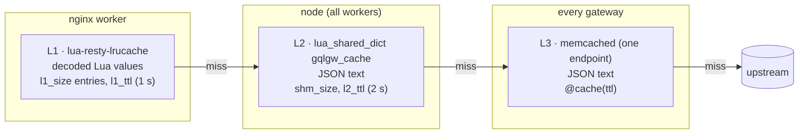
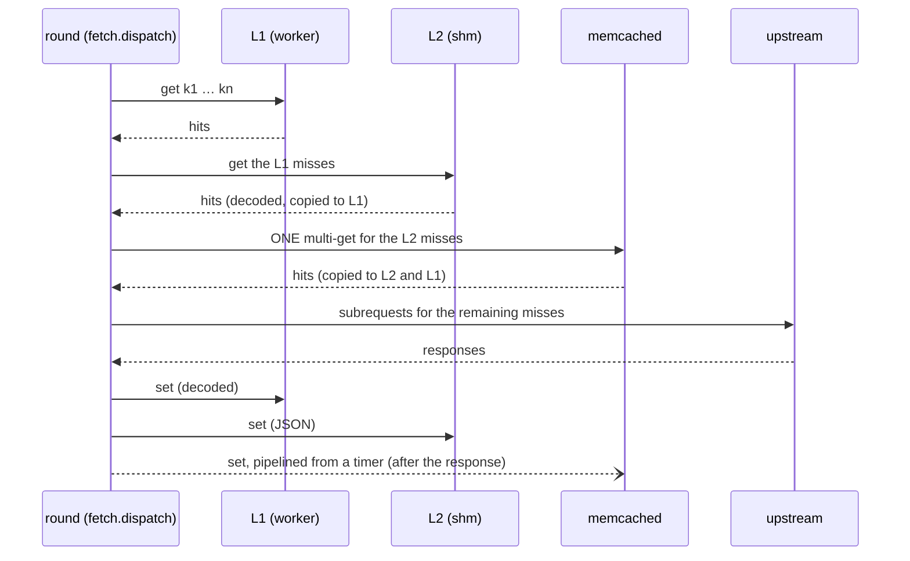
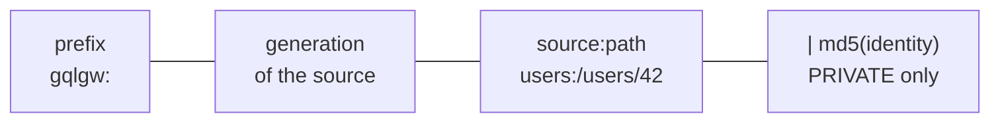
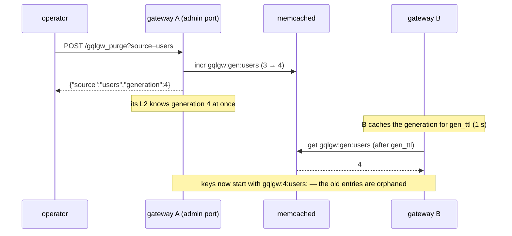

# Resource cache

The cache stores **REST resources**, not GraphQL responses. The key of a cached value is the
request that produced it (`users:/users/42`), so every query that needs user 42 shares the entry,
whatever its selection.

## Three levels



| Level | Scope | Holds | TTL of an entry | Optional |
|---|---|---|---|---|
| L1 | one worker | decoded values: no JSON decoding on a hit | `min(ttl, l1_ttl)` | `l1_size = 0` disables it |
| L2 | one node | JSON text | `min(ttl, l2_ttl)` | `shm_size = 0` disables it |
| L3 | all gateways | JSON text | `ttl` from `@cache` | no `[cache.memcached]` section, no L3 |

L1 and L2 are short-lived on purpose. They absorb bursts: the same entity read by many requests
in the same second. memcached holds the real TTL and is shared, so a gateway that just started
benefits from what the others fetched. Without memcached, L2 alone behaves as a per-node cache
capped at `l2_ttl`.

## Read and write paths



memcached writes never delay the response: they are queued to an `ngx.timer` and sent as one
pipeline.

## What gets cached

- Only `GET` routes with `@cache`, on the field or on the type it returns. The field wins.
- `404` responses and missing batch items: a negative entry, for `min(ttl, negative_ttl)` (5 s).
- Batch items, each under the key of its **single** fetch.
- Never: mutations, failed responses (`5xx`, invalid JSON, timeouts).

```graphql
type User @cache(ttl: 300) { id: ID! name: String! }          # every field returning a User

type Query {
  me: User @fetch(source: "users", path: "/me") @cache(ttl: 30, scope: "PRIVATE")   # overrides
}
```

## Keys



`gqlgw:3:users:/users/42`, or `gqlgw:3:users:/me|5d41402a…` with `scope: "PRIVATE"`. A key longer
than 200 bytes is replaced by its MD5 (memcached accepts 250 bytes).

!!! warning "Per-user data needs the PRIVATE scope"
    The key is the upstream request. If `/me` answers differently for each caller, a `PUBLIC`
    entry would serve the first caller's data to everyone. `PRIVATE` adds a hash of the
    `private_header` value (default `Authorization`) to the key. See
    [Auth context forwarding](../examples/auth.md).

## Purge: generations, not deletions

Purging a source increments its **generation**, which is part of every key. Old entries are not
deleted: they are never read again and expire on their own.



Without memcached, the generation lives in the node's L2, so a purge only applies to that node.

## When memcached fails

The cache is **fail-open**. A connection error or a timeout (`[cache.memcached] timeout`, 100 ms by
default) marks memcached as down for `down_ttl` (5 s), for every worker of the node. During that time the
gateway uses L1 and L2 and goes to the upstreams; `gqlgw_memcached_errors_total` counts the
failures. Then it tries again.
