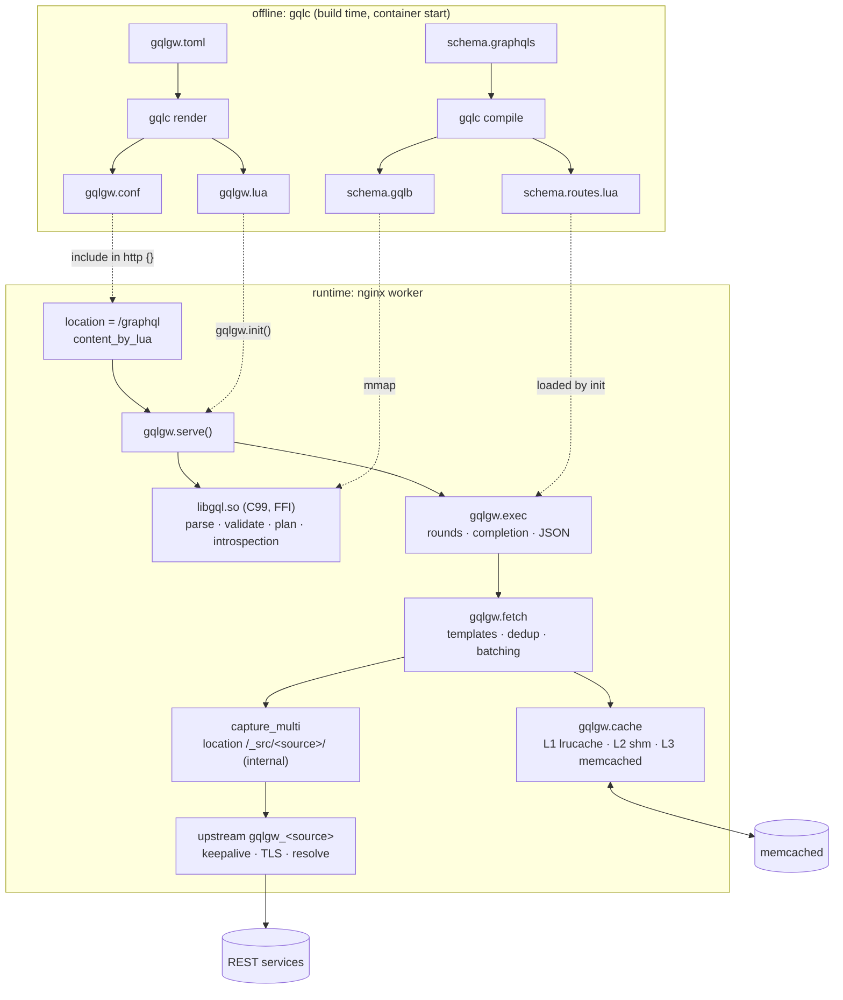

# Architecture

gqlgw has two halves. One runs **offline** (the `gqlc` compiler). The other runs **inside nginx**: a
C library called through LuaJIT FFI, plus Lua modules. Both halves share the same C code.

## Who does what

The split follows one rule: **the C side only handles what depends on the schema, the query and
the variables. Everything that depends on data is in Lua.**

| | C (`libgql.so`, `gqlc`) | Lua (`lua/gqlgw/`) | nginx |
|---|---|---|---|
| Input | schema, query text, variables | plan, JSON from the services | HTTP |
| Work | parsing, validation, variable coercion, fragment/`@skip`/`@include` normalization, introspection | fetch rounds, cache, batching, JSON → GraphQL mapping, result coercion, null propagation, serialization | connections, keepalive, TLS, DNS, timeouts, headers |
| I/O | none: pure and fuzzable | subrequests, shm, memcached | everything |
| Failure mode | an error list | field errors, partial data | upstream status |

The C code is GNU C99 with no dependency. The same sources build `gqlc` (the CLI) and
`libgql.so` (the FFI library). The Lua side uses only libraries bundled with OpenResty: cjson,
lrucache, memcached and string.buffer.

## Components

=== "C (src/)"

    | File | Role |
    |---|---|
    | `lexer.c`, `parser.c` | GraphQL lexer and parser (SDL and executable documents), hard limits, positions |
    | `sdl.c`, `schema.c` | schema model: flat arrays, no pointers; type system and gateway directive validation |
    | `gqlb.c` | writes the `.gqlb` binary and maps it at runtime (every bound checked) |
    | `routes.c` | writes `schema.routes.lua` (the parsed `@fetch`/`@batch`/`@cache` templates) |
    | `validate.c` | every validation rule of the spec (section 5) |
    | `plan.c` | operation selection, variables, CollectFields → flat execution plan |
    | `introspect.c` | `__schema` / `__type` rendered straight to JSON |
    | `toml.c`, `config.c`, `render.c` | TOML 1.1 parser, `gqlgw.toml` model, nginx/Lua rendering (`gqlc` only) |
    | `api.c`, `gql.h` | the FFI API |

=== "Lua (lua/gqlgw/)"

    | Module | Role |
    |---|---|
    | `init.lua` | `init()` (init_by_lua), `serve()` (content), `log()` (log phase), `metrics()`, `purge()` |
    | `http.lua` | GraphQL over HTTP: methods, media types, status codes |
    | `ffi.lua`, `schema.lua` | FFI binding; Lua tables derived from the schema and the routes |
    | `exec.lua` | resolution by rounds, completion, null propagation, ordered serialization |
    | `fetch.lua` | one round: templates, deduplication, cache lookups, batching, `capture_multi` |
    | `cache.lua` | L1 / L2 / L3, generations (purge), fail-open memcached |
    | `metrics.lua` | Prometheus counters and histograms |

## Design choices

- **The SDL is the source of truth.** Routing is declared on the fields; `gqlgw.toml` only says
  where each source lives and how to reach it.
- **Compile once.** The schema is parsed and validated by `gqlc` and stored as flat arrays. At
  runtime, `libgql.so` maps the file: there is no SDL parsing in nginx.
- **Subrequests, not a Lua HTTP client.** Upstream calls go through internal nginx locations, so
  keepalive pools, TLS, DNS re-resolution, timeouts and logging are nginx's.
- **Cache keys are REST resources** (`source:path`), not GraphQL selections. Two different queries
  that need user 42 share one entry.
- **Single memcached endpoint.** It can be a mcrouter: clustering is not the gateway's job.

Next: [the build and deploy pipeline](pipeline.md), then [the life of a request](request.md).
