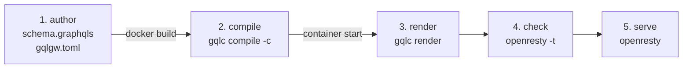
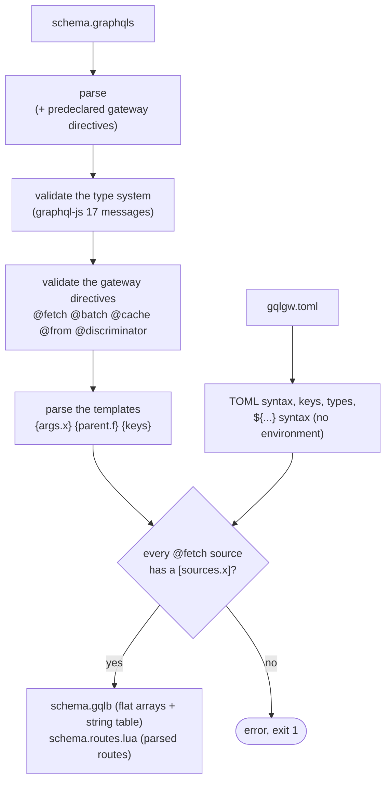
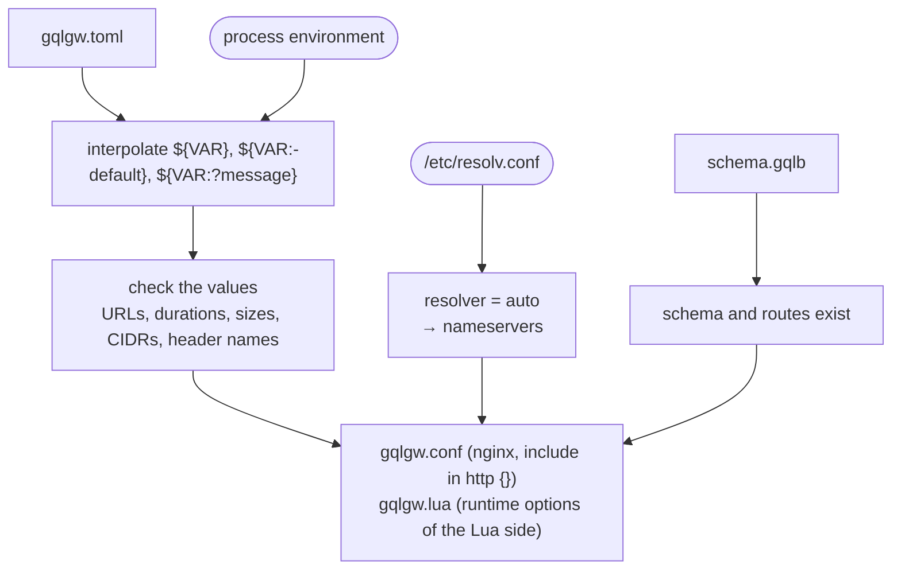
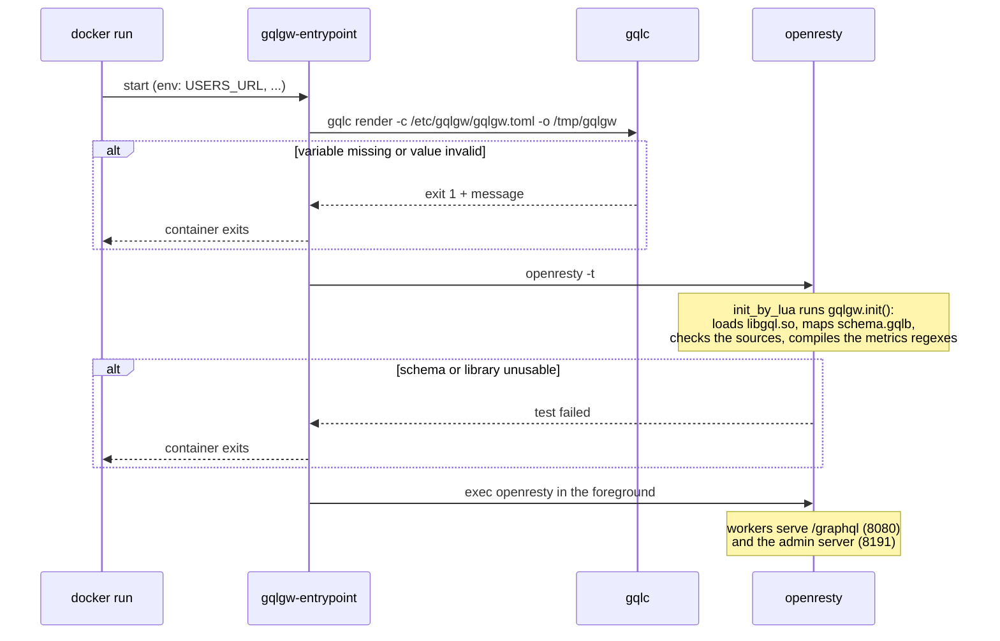

# Build and deploy pipeline

A gateway goes through five steps. Each one checks what it can, as early as it can.



| Step | When | Command | Reads | Writes |
|---|---|---|---|---|
| compile | image build | `gqlc compile -c gqlgw.toml schema.graphqls` | SDL, TOML (unrendered) | `schema.gqlb`, `schema.routes.lua` |
| render | container start | `gqlc render -c gqlgw.toml -o /tmp/gqlgw` | TOML, environment, `/etc/resolv.conf`, `schema.gqlb` | `gqlgw.conf`, `gqlgw.lua` (mode 0600) |
| check | container start | `openresty -t` | rendered files, `schema.gqlb`, `libgql.so` | — |
| serve | container start | `exec openresty` | same | — |

## 1. Compile: the schema becomes data



`schema.gqlb` is the schema model **as it lives in memory**: arrays of fixed-size records that
point to each other by index, plus a string table. At runtime, `libgql.so` maps it with `mmap`
and checks every bound, without parsing anything. `schema.routes.lua` holds the parsed
`@fetch` / `@batch` / `@cache` arguments, loaded by `gqlgw.init`.

Errors carry a position and stop the build:

```text
schema.graphqls:2:23: @fetch(path:) of Query.user: unknown argument "uid".
schema.graphqls:3:59: @batch on Query.posts requires the @fetch path to reference exactly one {parent.*} key.
gqlgw.toml:2:1: Unknown key "listne" in [gateway].
gqlgw.toml: @fetch(source: "orders") on Query.orders: no [sources.orders] in the configuration
```

A `[sources.x]` that no `@fetch` uses gives a warning, not an error.

## 2. Render: configuration meets environment



- Rendering happens **at start**, so one image runs in every environment. The Lua side never
  reads the environment: it reads `gqlgw.lua`.
- Secrets interpolated into the files (`set_headers = { X-Api-Key = "${KEY}" }`) end up in files
  written with mode `0600`, under `/tmp/gqlgw` in the image (a tmpfs with `--read-only`).
- A missing variable is fatal and names its position:
  `gqlgw.toml:5:7: Environment variable USERS_URL is not set (use ${USERS_URL:-default} to give a default value).`
- With `--locations-only`, `gqlgw.conf` is replaced by `gqlgw.http.conf` and
  `gqlgw.locations.conf` ([example](../examples/locations-only.md)).

## 3. Check, then serve

The image entrypoint chains everything and only starts nginx if every step passed:



`gqlgw.init()` runs in the nginx master, before the fork. It loads `libgql.so`, maps the schema
and builds the Lua tables, so workers share them copy-on-write.

## Changing things

| What changed | What to do |
|---|---|
| `schema.graphqls` | rebuild the image (`gqlc compile`), redeploy |
| `gqlgw.toml` | rebuild the image (the TOML is checked against the schema at build time) |
| an environment variable | restart the container (render runs again) |
| outside Docker | `gqlc compile` and/or `gqlc render`, then `nginx -s reload` |

Next: [the life of a request](request.md).
