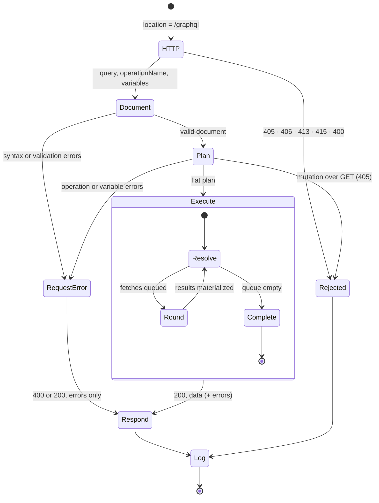
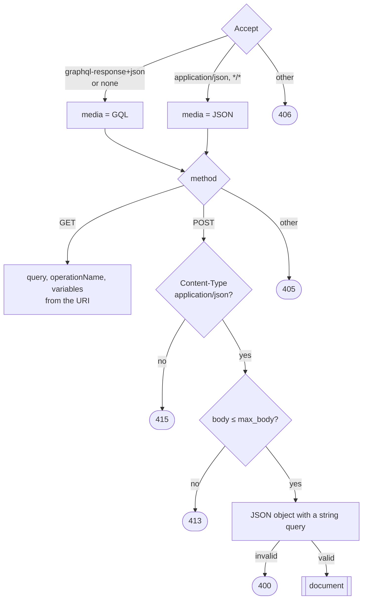
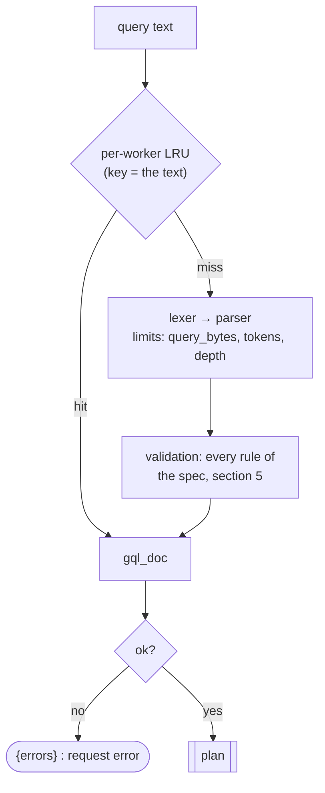
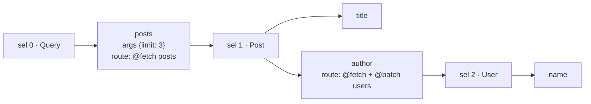
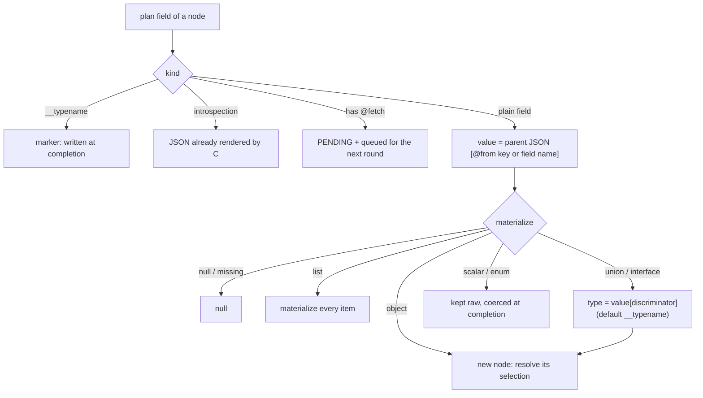
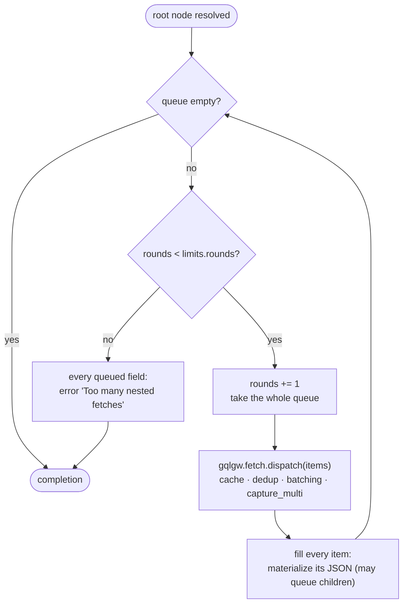
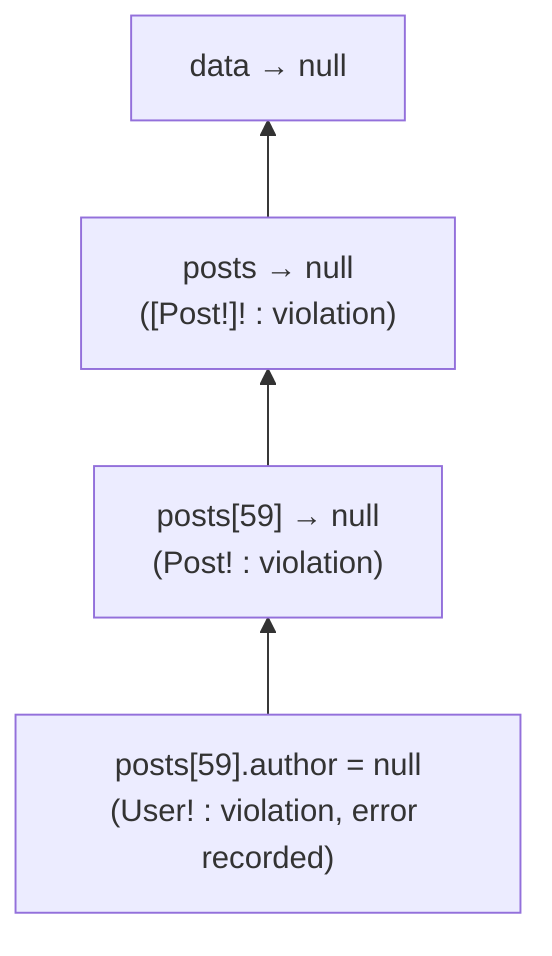
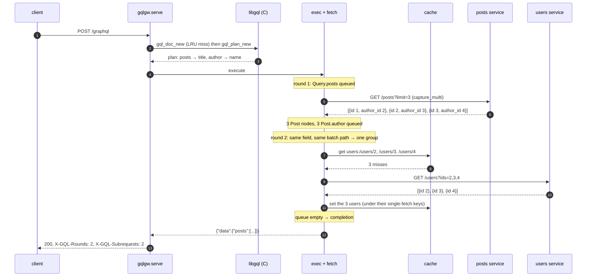
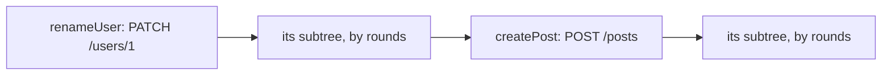

# Life of a request

This page follows one `POST /graphql` from the socket to the response. The machine has five
phases. Two run in C (document, plan), three in Lua (HTTP, execution, log).



| Phase | Where | Input → output | Fails with |
|---|---|---|---|
| HTTP | `gqlgw.http` (Lua) | request → `{query, operationName, variables}` | 4xx, no `data` |
| Document | `libgql` (C) | query text → validated document (cached per worker) | request error |
| Plan | `libgql` (C) | document + operation + variables → flat plan | request error |
| Execute | `gqlgw.exec`, `gqlgw.fetch` (Lua) | plan + upstream JSON → response JSON | field errors, partial `data` |
| Log | `gqlgw.log` (Lua) | request context → metrics, `$gql_*` variables | never |

## 1. HTTP



The media type decides how request errors are reported later: `400` with
`application/graphql-response+json`, `200` with `application/json` (the GraphQL-over-HTTP
convention). See [GraphQL over HTTP](../reference/http.md).

## 2. Document: parse and validate (C)



Validated documents are cached per worker (512 entries), invalid ones too, so a client that
repeats a query skips parsing and validation. The validation messages are graphql-js 17's,
without the "Did you mean" suggestions.

## 3. Plan: from a document to flat arrays (C)

`gql_plan_new(schema, doc, operationName, variables)`:

1. selects the operation (`operationName`, or the only one);
2. coerces the variables and every argument (defaults, input objects, `@oneOf`, lists);
3. runs **CollectFields**: fragments are inlined, `@skip` / `@include` evaluated, fields merged
   by response key;
4. emits one **selection** per (concrete object type, merged selection set). Selections are
   memoized, so the plan is a DAG and fragment-heavy queries stay small.

For `{ posts(limit: 3) { title author { name } } }`:



The plan is a few arrays of `uint32` (selections, fields, abstract cases) plus a string area for
the response keys and the coerced arguments as JSON. Lua reads them through FFI, without copying.
Introspection fields are rendered to JSON by the C side at this step.

## 4. Execute: resolution by rounds, then completion (Lua)

Execution has two passes. **Resolution** builds a tree of nodes over the raw upstream JSON and
fetches what is missing. **Completion** walks that tree in plan order and writes the response.

### Resolution: what happens to each field



A field without `@fetch` never costs a request: it is read from the JSON that the parent
fetch returned. A field with `@fetch` is queued with its parent node, so its templates can read
the parent's raw JSON (`{parent.authorId}`).

### Rounds



Every fetch that is ready leaves in the same round, whatever its depth in the response. The
number of rounds is the **depth of the fetch chain**, not the size of the lists: 100 posts and
their 100 authors take 2 rounds. What happens inside a round is detailed in
[Rounds and batching](batching.md).

### Completion: coercion and null propagation

Completion walks the plan in order, so the response keys follow the query. For each value:

- **leaves** are coerced to their type (`Int` must fit 32 bits, `ID` accepts strings and
  integers, enums must be known values, custom scalars pass through);
- **errors** (failed fetch, failed coercion) become an entry in `errors` with `path` and
  `locations`, and the value becomes `null`;
- a `null` in a **non-null** position propagates to the nearest nullable parent, as the spec
  requires.

A real example from the example gateway: post 60 has `author_id: "999"`, which the users
service does not know, and the schema says `author: User!` inside `posts: [Post!]!`.



```json
{"errors":[{"message":"Cannot return null for non-nullable field Post.author.",
            "locations":[{"line":1,"column":25}],"path":["posts",59,"author"]}],
 "data":null}
```

With `author: User` (nullable), only that author would be `null` and the other 59 posts would
be returned. Choose non-null types for what the services guarantee.

## 5. Log

The log phase (`log_by_lua`, generated by `gqlc render`) records the request metrics:
operation, type, result, duration, rounds, error counts. It also fills the variables of the
`gqlgw` access log format: `rounds=2 sub=2 cache=l1=0;l2=0;l3=0;miss=3`.

## A complete example

`{ posts(limit: 3) { title author { name } } }`, with `Post.author` batched and `User` cached:



The same query a second time: round 1 fetches the posts, round 2 finds the three users in the
cache. One subrequest.

## Mutations

Root fields of a mutation run **one after the other**, as the spec requires: the first field's
fetch and its whole subtree complete before the second field starts. Below the root, the rounds
work as for queries. Mutations are never cached and cannot be sent with `GET`.



## Limits

| Limit (`[limits]`) | Default | Enforced in | When exceeded |
|---|---|---|---|
| `query_bytes`, `tokens`, `depth` | 65536, 20000, 32 | C, parsing | request error |
| `errors` | 100 | C, validation | validation stops after that many errors |
| `plan_fields`, `memory` | 20000, 16m | C, plan | request error |
| `rounds` | 16 | Lua | field errors on the remaining fetches |
| `fetches` | 1000 | Lua | field errors on the round that would exceed it |
| `concurrency` | 64 | Lua | subrequests sent in slices of 64 |
| `response_bytes` | 16m | Lua | field error for that response |
| `[gateway] max_body` | 1m | nginx + Lua | 413 |
