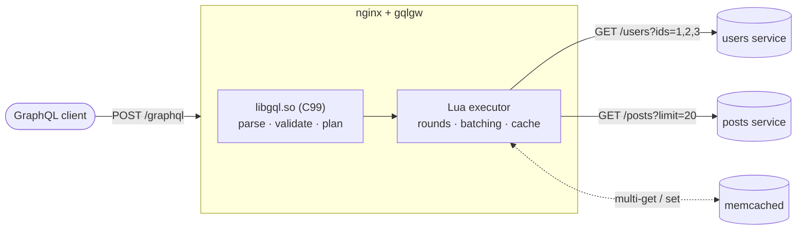

# gqlgw

**A GraphQL API described in SDL, served by nginx, resolved by your REST services.**

gqlgw is an SDL-first GraphQL gateway for [OpenResty](https://openresty.org). You write a GraphQL
schema and annotate its fields with the REST call that resolves them. gqlgw compiles the schema
once, generates the nginx configuration, and answers GraphQL requests by calling your services. N+1
patterns are removed by **batching**, and a **three-level resource cache** sits in front of the
services.



## In one example

=== "Schema"

    ```graphql
    type Query {
      posts(limit: Int = 20): [Post!]! @fetch(source: "posts", path: "/posts?limit={args.limit}")
    }

    type Post {
      title: String!
      authorId: ID! @from(key: "author_id")
      author: User!
        @fetch(source: "users", path: "/users/{parent.authorId}")
        @batch(path: "/users?ids={keys}", match: "id")
    }

    type User @cache(ttl: 300) {
      id: ID!
      name: String!
    }
    ```

=== "Configuration"

    ```toml
    [sources.posts]
    url = "${POSTS_URL}"

    [sources.users]
    url = "${USERS_URL}"
    ```

=== "Query"

    ```graphql
    { posts(limit: 3) { title author { name } } }
    ```

=== "Upstream calls"

    | Round | Source | Request | Why |
    |---|---|---|---|
    | 1 | `posts` | `GET /posts?limit=3` | `Query.posts` |
    | 2 | `users` | `GET /users?ids=2,3,4` | the three `Post.author` fields, batched into one call |

    The next identical query makes **one** call: the authors come from the cache.

## What you get

<div class="grid cards" markdown>

-   **SDL is the contract**

    ---

    Routing lives next to the fields it resolves: `@fetch`, `@batch`, `@cache`, `@from`,
    `@discriminator`. The directives are predeclared and hidden from introspection.

    [:octicons-arrow-right-24: SDL directives](reference/directives.md)

-   **Compiled, never interpreted at start**

    ---

    `gqlc compile` checks the schema and the configuration when the image is built. The gateway
    never starts from an uncompiled `.graphqls`.

    [:octicons-arrow-right-24: Build and deploy pipeline](how-it-works/pipeline.md)

-   **No N+1**

    ---

    Fields are resolved in rounds: every pending fetch of a round leaves at once, identical
    requests are merged, and `@batch` fields share one call per round.

    [:octicons-arrow-right-24: Rounds and batching](how-it-works/batching.md)

-   **A cache per REST resource**

    ---

    Per-worker LRU, `lua_shared_dict`, then memcached. Cache keys are REST resources, so every
    query shares them. Purge one source with one request.

    [:octicons-arrow-right-24: Resource cache](how-it-works/caching.md)

-   **nginx does the HTTP**

    ---

    `gqlc render` turns `gqlgw.toml` into an nginx block: upstreams with keepalive and DNS
    re-resolution, TLS verification, header allowlists, timeouts.

    [:octicons-arrow-right-24: Generated configuration](reference/nginx.md)

-   **Spec-conformant, and measured**

    ---

    Validation and introspection match graphql-js 17, checked by differential fuzzing. Prometheus
    metrics come built in.

    [:octicons-arrow-right-24: Conformance](project/conformance.md)

</div>

## Where to start

- [Getting started](getting-started.md): run the example gateway with Docker, then build your own.
- [How it works](how-it-works/index.md): the architecture, the pipeline and the life of a request.
- [Examples](examples/index.md): full server, locations only, batching, auth forwarding, mutations.
