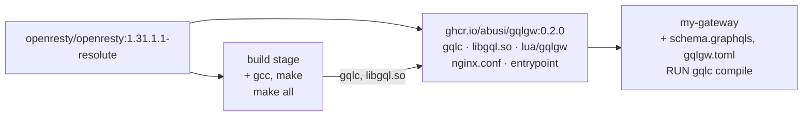
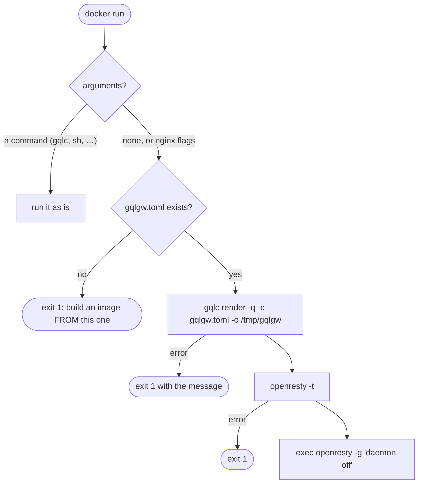

# Docker image

Releases are published on the GitHub container registry, for `linux/amd64` and `linux/arm64`:

```bash
docker pull ghcr.io/abusi/gqlgw:0.2.0
```

| Tag | |
|---|---|
| `0.2.0` | one release |
| `0.2` | the latest `0.2.x` |
| `latest` | the latest release |

`make image` builds the same image locally, as `gqlgw:<version>` and `gqlgw:latest`. Both start
from the official `openresty/openresty:1.31.1.1-resolute` image (Ubuntu, glibc). The image
contains the gateway but no schema: you build your gateway **from** it.



## Layout

| Path | Contents |
|---|---|
| `/usr/local/bin/gqlc` | the compiler and renderer |
| `/usr/local/lib/gqlgw/libgql.so` | the FFI library |
| `/usr/local/openresty/site/lualib/gqlgw/` | the Lua modules |
| `/usr/local/openresty/nginx/conf/nginx.conf` | includes `/tmp/gqlgw/gqlgw.conf` and `/etc/gqlgw/conf.d/*.conf` |
| `/etc/gqlgw/` | your `gqlgw.toml`, `schema.graphqls`, the compiled schema; `conf.d/`, `server.d/`, `sources.d/` |
| `/tmp/gqlgw/` | written at start: `gqlgw.conf`, `gqlgw.lua` (mode 0600), pid, temp files |
| `/usr/local/share/gqlgw/` | `Dockerfile.example`, `gqlgw.toml.example`, `LICENSE` |

## Your gateway

```dockerfile
FROM ghcr.io/abusi/gqlgw:0.2.0
COPY schema.graphqls gqlgw.toml /etc/gqlgw/
RUN gqlc compile -c /etc/gqlgw/gqlgw.toml /etc/gqlgw/schema.graphqls
# optional:
COPY server.d/  /etc/gqlgw/server.d/
COPY sources.d/ /etc/gqlgw/sources.d/
COPY conf.d/    /etc/gqlgw/conf.d/
```

```bash
docker run --read-only --tmpfs /tmp -p 8080:8080 -p 8191:8191 \
    -e USERS_URL=http://users:8080 -e POSTS_URL=http://posts:8080 my-gateway
```

## Runtime properties

- **Non-root.** The image runs as `gqlgw` (uid 10001). Ports 8080 and 8191 need no privilege.
- **Read-only.** Everything written at runtime lives in `/tmp/gqlgw`, so
  `--read-only --tmpfs /tmp` works as is. `/run` is not used: Docker mounts its tmpfs as
  root-owned.
- **Logs** go to stdout (access log) and stderr (error log).
- **Stop** with `SIGQUIT` (graceful), the image's `STOPSIGNAL`.
- **Configuration file**: `/etc/gqlgw/gqlgw.toml`, or the path in `GQLGW_CONFIG`.

## Entrypoint



## Compose

The example of the repository runs the gateway with memcached and a mock backend:

```yaml
--8<-- "examples/docker/compose.yaml"
```

## Provenance

Each release image carries a signed SLSA build provenance attestation, which ties it to the
workflow run and the commit that built it:

```bash
gh attestation verify oci://ghcr.io/abusi/gqlgw:0.2.0 -R abusi/gqlgw
```

## Testing the image

`make docker-test` builds the image and the example, starts **two** read-only gateways that share
memcached, and checks: queries, batching, the L3 cache seen from the second gateway, metrics,
purge, the non-root user, the `0600` rendered files, the refusal to start without `USERS_URL`,
and command passthrough. The CI runs it on every pull request, and the release workflow before
publishing an image.
