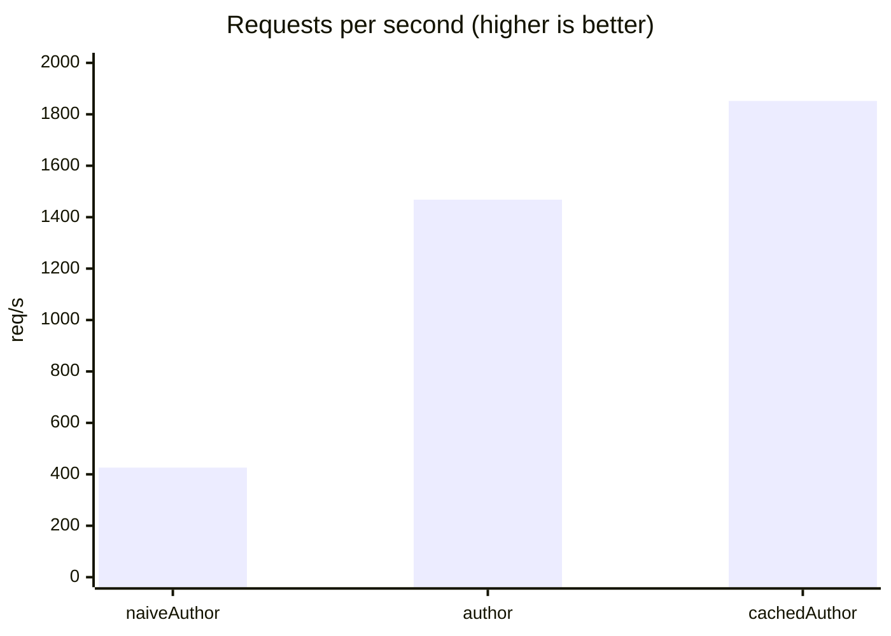

# Benchmarks

`make bench` runs [wrk](https://github.com/wg/wrk) against a local gateway and a mock backend
that answers after 2 ms, then writes `bench/RESULTS.md`.

The query: `{ posts(limit: 100) { id title <author field> { name } } }`, 100 posts by 100 distinct
authors, with three versions of the author field (see
[Batch vs no batch](../examples/batching.md)).

## Results

wrk for 10 s with 16 connections, OpenResty with 2 workers, 4 CPUs (x86_64), 2026-10-11:

| Variant | Subrequests per query | req/s | Latency avg | Latency p99 |
|---|---|---|---|---|
| `naiveAuthor` | 101 (then 101) | 425.73 | 47.98 ms | 577.41 ms |
| `author` (`@batch`) | 2 (then 2) | 1467.53 | 10.89 ms | 15.21 ms |
| `cachedAuthor` (`@batch` + `@cache`) | 2 (then 1) | 1851.52 | 8.64 ms | 12.78 ms |



## Cost of the metrics

Same query, with Prometheus metrics (log phase, upstream timing, as generated by `gqlc render`)
and without: 5 alternating runs of 8 s per configuration. Medians:

| Variant | Without metrics | With metrics | Difference |
|---|---|---|---|
| `author` | 1464.54 req/s | 1442.61 req/s | −1.5 % |
| `cachedAuthor` | 1925.46 req/s | 1951.19 req/s | +1.3 % |

The difference is within the measurement noise of a busy desktop machine. A first version, which
built a label string for every increment, cost 4.7 % on `cachedAuthor`: the keys are now memoized
and the cache lookups aggregated per round.

## Running it

```bash
make bench                                   # writes bench/RESULTS.md
DURATION=30s CONNS=64 make bench             # longer, more connections
METRICS=1 OUT=/tmp/with-metrics.md make bench
```
