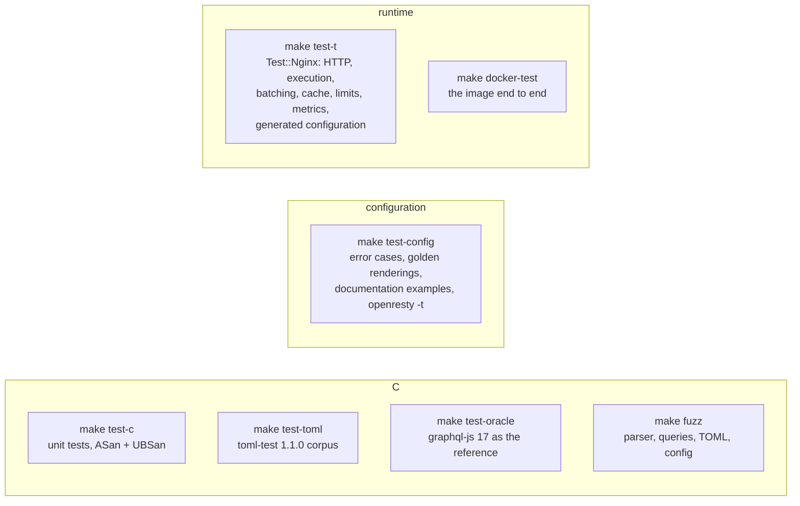

# Development

## Build and test

```bash
make deps        # OpenResty 1.31.1.1, Test::Nginx, graphql-js, toml-test, in .deps/ (no sudo)
make             # build/libgql.so + build/gqlc
make test        # everything below except Docker and fuzzing
make docker-test # the image, two gateways, memcached, a mock backend
make fuzz        # libFuzzer, FUZZ_TIME=60 seconds per target
make bench       # wrk: naive vs @batch vs @batch + @cache
```

System packages (Ubuntu): `build-essential libpcre2-dev libssl-dev zlib1g-dev` (to build
OpenResty), `memcached`, `cpanminus`, `nodejs npm` (graphql-js), `python3` (toml-test),
`clang llvm libclang-rt-dev` (fuzzing), `wrk` (bench), `docker.io docker-buildx docker-compose-v2`.

## What the tests cover



| Target | Checks |
|---|---|
| `test-c` | lexer, parser, schema, validation, plan, JSON, TOML, config: built with ASan and UBSan |
| `test-toml` | 214/214 valid and 467/467 invalid documents of toml-test 1.1.0 |
| `test-config` | `gqlgw.toml` error messages with positions, byte-exact golden renderings, the `examples/*/gqlgw.toml` of this documentation, `openresty -t` on all of them |
| `test-oracle` | validation verdicts and messages, introspection: identical to graphql-js 17 |
| `test-t` | the gateway in nginx, with mock backends that count their hits |
| `docker-test` | two read-only gateways sharing memcached, purge, metrics, non-root, refusal to start without a variable |
| `fuzz` | 4 libFuzzer targets with ASan and UBSan, plus the regression inputs of past bugs |

## Continuous integration

`.github/workflows/ci.yml` runs on **pull requests** (and on demand), not on branch pushes:

| Job | Runs in | Does |
|---|---|---|
| `make test` | `openresty/openresty:1.31.1.1-resolute` (the image base) | `make deps` with the image's OpenResty, then every `make test-*` target |
| fuzzing | the same image + clang | regressions, then 30 s per fuzz target |
| `make docker-test` | the runner (Docker) | the image end to end |
| documentation | Python | `zensical build --strict` (broken links fail) |

A new push to the pull request cancels the previous run.

## Documentation

The site is built with [Zensical](https://zensical.org) from `docs/` and `zensical.toml`, and
published to GitHub Pages by `.github/workflows/docs.yml` on every push to `main`.

```bash
python3 -m venv .venv && .venv/bin/pip install -r requirements-docs.txt
.venv/bin/zensical serve          # http://localhost:8000, live reload
.venv/bin/zensical build --strict # site/
```

Diagrams are [Mermaid](https://mermaid.js.org) code blocks. Configuration examples are included
from `examples/` with `--8<-- "path"`, so they are tested by `make test-config`.

## Layout

| Path | |
|---|---|
| `src/` | the C core (`libgql.so`, `gqlc`) |
| `lua/gqlgw/` | the Lua runtime |
| `t/` | Test::Nginx suite (`t/lib/mock.lua`: mock backends) |
| `tests/` | C tests, oracle, toml-test runner, config cases, fuzzing, Docker test |
| `examples/` | Docker example, documentation examples |
| `bench/` | wrk benchmark |
| `docker/`, `Dockerfile` | the image |
| `docs/`, `zensical.toml` | this site |
| `PLAN.md` | design notes and milestones |
