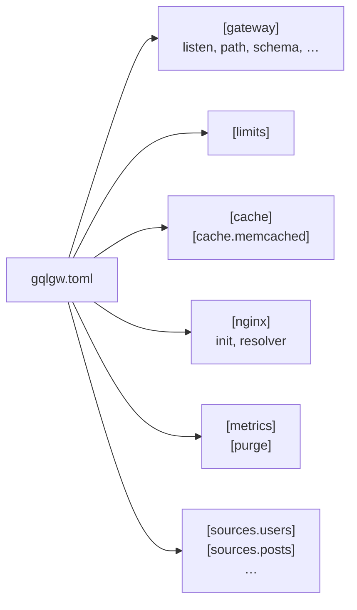

# gqlgw.toml

The gateway configuration is one [TOML 1.1](https://toml.io/en/v1.1.0) file. gqlgw parses it with
its own parser, which passes the whole `toml-test` corpus. Every section is optional except one
`[sources.<name>]` per source used by the schema.



## Values

| Kind | Written as | Examples |
|---|---|---|
| size | integer (bytes), or string with `k`, `m`, `g` (powers of 1024) | `65536`, `"256k"`, `"16m"` |
| duration | nginx syntax: digits with `ms`, `s`, `m`, `h`, `d` | `"500ms"`, `"3s"`, `"1m30s"` |
| listen | integer port, or string passed to nginx `listen` | `8080`, `"127.0.0.1:8080"`, `"0.0.0.0:8443 ssl"` |
| list | array of strings, or one string | `["10.0.0.0/8"]`, `"auto"` |
| path | relative paths start from the directory of `gqlgw.toml` | `schema`, `routes`, `lib`, `ca`, `socket` |

An unknown key, a wrong type or a value out of range is an error with its position:
`gqlgw.toml:2:1: Unknown key "listne" in [gateway].`

### Environment variables

Every string value can use the environment. Interpolation happens in `gqlc render`, when the
container starts; `gqlc compile` only checks the syntax.

| Syntax | Result |
|---|---|
| `${VAR}` | the value; **error** if `VAR` is not set |
| `${VAR:-default}` | the value, or `default` if `VAR` is unset or empty |
| `${VAR:?message}` | the value; error with `message` if unset or empty |
| `$${` | a literal `${` |
| `$` alone | a literal `$` (regexes like `^Foo$`, keys like `k$y` need no escaping) |

A typed field can be written as a string to use a variable: `port = "${MEMCACHED_PORT:-11211}"`,
`debug_headers = "${DEBUG:-false}"`. The result is converted to the expected type.

## `[gateway]`

| Key | Default | |
|---|---|---|
| `listen` | `8080` | the `listen` of the gateway `server {}` (ignored with `--locations-only`) |
| `server_name` | `"_"` | idem |
| `path` | `"/graphql"` | the GraphQL location (exact match) |
| `schema` | `"schema.gqlb"` | compiled schema, written there by `gqlc compile -c` |
| `routes` | next to `schema` | `schema.routes.lua` |
| `lib` | `/usr/local/lib/gqlgw/libgql.so` | the FFI library (the default follows `PREFIX` at build time) |
| `access_log` | inherited | a path (format `gqlgw`), or `"off"` |
| `introspection` | `true` | `__schema` / `__type` queries |
| `strict_path_args` | `true` | refuse `/`, `\`, `.` and `..` as path segment values |
| `debug_headers` | `false` | `X-GQL-Rounds`, `X-GQL-Subrequests`, `X-GQL-Batches`, `X-GQL-Cache`, `X-GQL-Doc-Cache` |
| `max_body` | `"1m"` | largest request body (`client_max_body_size`) |

## `[limits]`

| Key | Default | Bounds |
|---|---|---|
| `query_bytes` | `65536` | size of the query text |
| `tokens` | `20000` | lexer tokens of the document |
| `depth` | `32` | selection depth |
| `errors` | `100` | validation errors reported |
| `plan_fields` | `20000` | fields of the execution plan (after fragment expansion) |
| `memory` | `"16m"` | memory of one document or plan |
| `rounds` | `16` | fetch rounds per request |
| `fetches` | `1000` | upstream requests per GraphQL request |
| `concurrency` | `64` | subrequests in flight per request |
| `response_bytes` | `"16m"` | one upstream response |

See [where each limit applies](../how-it-works/request.md#limits).

## `[cache]`

| Key | Default | |
|---|---|---|
| `shm_size` | `"64m"` | L2 (`lua_shared_dict gqlgw_cache`); `0` disables L2 |
| `l1_size` | `10000` | L1 entries per worker; `0` disables L1 |
| `l1_ttl` | `1` | seconds (decimals allowed), cap for L1 |
| `l2_ttl` | `2` | seconds, cap for L2 |
| `negative_ttl` | `5` | seconds, cap for `404` and missing batch items |
| `gen_ttl` | `1` | seconds a source generation is cached per node (purge latency) |
| `down_ttl` | `5` | seconds memcached is skipped after a failure |
| `private_header` | `"Authorization"` | identity of `@cache(scope: "PRIVATE")` |
| `prefix` | `"gqlgw:"` | prefix of every cache key |

### `[cache.memcached]`

The L3 cache. Without this section, there is no L3.

| Key | Default | |
|---|---|---|
| `host`, `port` | `"127.0.0.1"`, `11211` | one endpoint (it can be a mcrouter) |
| `socket` | — | a unix socket instead of `host`/`port` |
| `timeout` | `100` | milliseconds, per operation |
| `pool_size` | `64` | keepalive connections per worker |
| `keepalive` | `60000` | milliseconds an idle connection is kept |

A `host` given by name is resolved by `[nginx] resolver`.

## `[nginx]`

| Key | Default | |
|---|---|---|
| `init` | `true` | generate `init_by_lua_block`; `false` if you call `gqlgw.init()` from your own |
| `resolver` | `"auto"` | DNS servers for upstreams and memcached; `auto` reads `/etc/resolv.conf` at render time |
| `resolver_valid` | `"10s"` | how long a DNS answer is kept |
| `resolver_ipv6` | `true` | `false` adds `ipv6=off` |

A source or memcached host given by name **requires** a resolver: `auto` with an empty
`resolv.conf`, or an empty list, is an error at render time.

## `[metrics]`

| Key | Default | |
|---|---|---|
| `enabled` | `true` | the admin `server {}` and the metric collection |
| `port` | `8191` | admin server `listen` (a port or an address); must differ from `[gateway] listen` |
| `path` | `"/gqlgw_metrics"` | Prometheus text format |
| `allow` | `[]` | IPs or CIDRs allowed on the admin server; empty: no filtering |
| `exclude_operations` | `[]` | PCRE regexes: matching operation names are counted as `__excluded` |
| `shm_size` | `"8m"` | `lua_shared_dict gqlgw_metrics` |
| `buckets` | `[0.005, …, 10]` | duration histogram buckets, in seconds |

## `[purge]`

| Key | Default | |
|---|---|---|
| `enabled` | `true` | served on the admin server |
| `path` | `"/gqlgw_purge"` | `POST <path>?source=<name>` |

## `[sources.<name>]`

One section per `@fetch(source: "<name>")`. The name matches `[A-Za-z0-9_-]+`.

| Key | Default | |
|---|---|---|
| `url` | **required** | `http(s)://host[:port][/prefix]`; the prefix is prepended to every path |
| `connect_timeout` | `"1s"` | |
| `send_timeout` | `"5s"` | |
| `read_timeout` | `"5s"` | a timeout is a field error |
| `keepalive` | `64` | idle connections per worker; `0` disables keepalive |
| `keepalive_timeout` | `"60s"` | |
| `forward_headers` | `["Authorization"]` | **allowlist** of client headers sent to the source |
| `drop_headers` | — | **denylist**: send every client header except these; exclusive with `forward_headers` |
| `set_headers` | `{}` | headers added to every request; literal values (a `$` stays a `$`) |
| `tls_verify` | `true` | `https`: verify the certificate and send SNI |
| `ca` | `/etc/ssl/certs/ca-certificates.crt` | trusted CAs for `tls_verify` |
| `tls_name` | host of the URL | name checked in the certificate and sent as SNI |
| `host_header` | host of the URL | the `Host` header |

Headers managed by the gateway cannot appear in `forward_headers`, `drop_headers` or
`set_headers`: `Host`, `Connection`, `Content-Length`, `Content-Type`, `Transfer-Encoding`,
`Accept-Encoding`, `TE`, `Keep-Alive`, `Upgrade`, `Expect`, `Proxy-Connection`.
See [Auth context forwarding](../examples/auth.md).

## Complete example

```toml
--8<-- "examples/full/gqlgw.toml"
```
