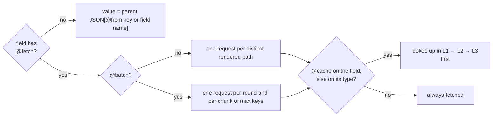

# SDL directives

`gqlc` predeclares five directives: do not write their definitions. They are checked when the schema
is compiled and **hidden from introspection**: clients see a plain GraphQL schema.

```graphql
directive @fetch(source: String!, path: String!, method: String! = "GET",
                 body: String, select: String) on FIELD_DEFINITION
directive @batch(path: String!, match: String!, max: Int! = 100, select: String) on FIELD_DEFINITION
directive @cache(ttl: Int!, scope: String! = "PUBLIC") on FIELD_DEFINITION | OBJECT | INTERFACE | UNION
directive @from(key: String!) on FIELD_DEFINITION
directive @discriminator(key: String!) on INTERFACE | UNION
```



## `@fetch`

Resolves the field with a request to a source.

| Argument | | |
|---|---|---|
| `source` | required | name of a `[sources.<name>]` of `gqlgw.toml`, `[A-Za-z0-9_-]+` |
| `path` | required | starts with `/`; template (see below); appended to the source URL |
| `method` | `"GET"` | `GET`, `POST`, `PUT`, `PATCH` or `DELETE` |
| `body` | — | template of the request body (JSON); not allowed with `GET` |
| `select` | — | dotted path into the response: `"data.items"` |

- Only on fields of **object types** (not on interface fields).
- Cannot be combined with `@from` on the same field.
- The response is decoded as JSON; see [upstream responses](../how-it-works/batching.md#upstream-responses).

## `@batch`

Fetches the field for many parents in one request.

| Argument | | |
|---|---|---|
| `path` | required | starts with `/`; contains `{keys}` exactly once and no `{parent.*}` |
| `match` | required | property of each returned item that holds its key |
| `max` | `100` | keys per request, 1 to 10000 |
| `select` | — | dotted path to the array in the response |

- Requires a `GET` `@fetch` whose path references **exactly one** `{parent.*}`: the key.
- `{keys}` is replaced by the URL-encoded keys joined with `,`.
- Items are matched to keys as strings. A missing key resolves to `null`.
- See [Rounds and batching](../how-it-works/batching.md) and the
  [example](../examples/batching.md).

## `@cache`

Caches the response of a `GET` route.

| Argument | | |
|---|---|---|
| `ttl` | required | seconds, ≥ 0 |
| `scope` | `"PUBLIC"` | `"PRIVATE"` adds a hash of `[cache] private_header` to the key |

- On a field (which must have `@fetch`), or on an object, interface or union type: it then applies
  to every `@fetch` field that returns that type. The field-level directive wins.
- Ignored for non-`GET` routes (with a warning on a field).
- See [Resource cache](../how-it-works/caching.md).

## `@from`

The JSON property that holds the field's value, when it differs from the field name:

```graphql
type Post {
  authorId: ID! @from(key: "author_id")
  createdAt: String @from(key: "created_at")
}
```

Only on object type fields without `@fetch`. Templates use the GraphQL name: `{parent.authorId}`
reads `author_id`.

## `@discriminator`

The JSON property that names the concrete type of a union or interface value. Default:
`__typename`. See [Unions and interfaces](../examples/abstract-types.md).

## Templates

`path`, `body` and `@batch(path:)` are templates.

| Placeholder | Value | In |
|---|---|---|
| `{args.name}` | an argument (coerced: defaults applied) | path, body |
| `{args.input.field}` | a field of an input object argument | path, body |
| `{args}` | every argument as a JSON object | body |
| `{parent.field}` | a field of the parent object, by its GraphQL name; must be a scalar or enum field without `@fetch` | path, body |
| `{keys}` | the batch keys | `@batch(path:)` only |

- **In a path**, values are URL-encoded. A `null` or missing argument gives an empty string
  (`/posts?tag=`). Lists are joined with `,`. With `[gateway] strict_path_args = true` (the
  default), a value placed before the `?` cannot contain `/` or `\`, nor be `.` or `..`: such a
  request becomes a field error instead of reaching another path of the service.
- **In a body**, values are JSON-encoded.
- A `{` that is not followed by `args`, `parent` or `keys` is literal: `"{\"name\": {args.name}}"`.
- Placeholders are checked at compile time: unknown arguments, unknown parent fields, `{keys}`
  outside `@batch` are errors.

## Compile errors

```text
schema.graphqls:2:23: @fetch(path:) of Query.user: unknown argument "uid".
schema.graphqls:3:59: @batch on Query.posts requires the @fetch path to reference exactly one {parent.*} key.
```

Other checks include: `@fetch(method:)` must be one of the five methods, `@fetch(body:)` is not
allowed with `GET`, `@batch` requires `@fetch`, `@cache` on a field requires `@fetch`,
`@from` cannot be combined with `@fetch`, and `{parent.x}` cannot reference a field resolved by
`@fetch`.
