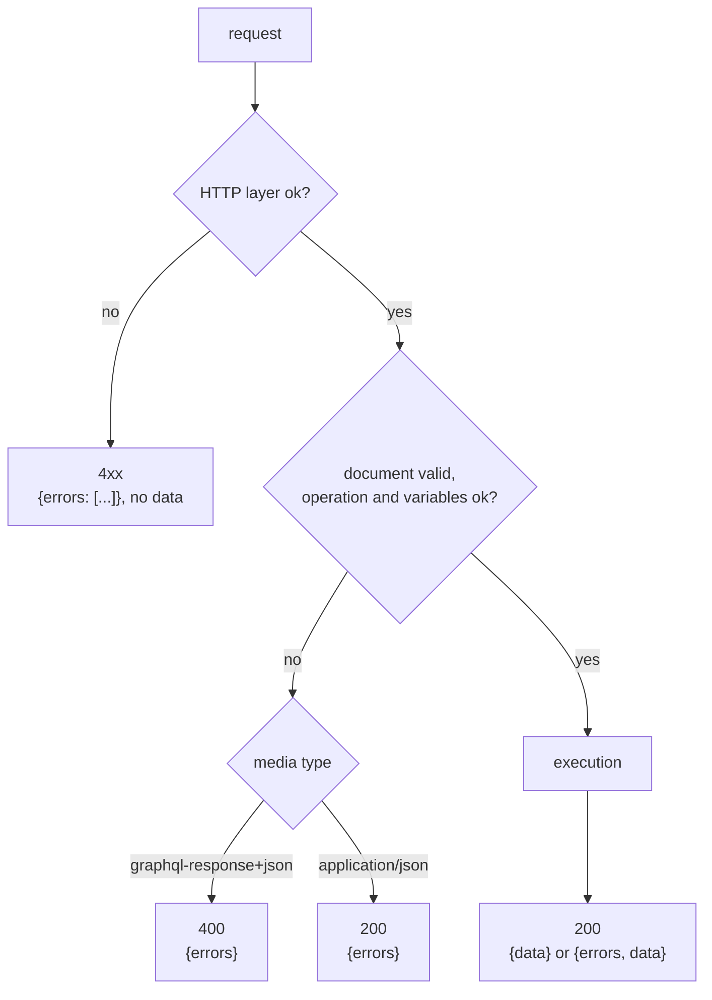

# GraphQL over HTTP

gqlgw follows the [GraphQL-over-HTTP](https://graphql.github.io/graphql-over-http/draft/) draft.

## Requests

=== "POST"

    ```http
    POST /graphql HTTP/1.1
    Content-Type: application/json
    Accept: application/graphql-response+json

    {"query": "query One($id: ID!) { user(id: $id) { name } }",
     "operationName": "One", "variables": {"id": "1"}}
    ```

    `Content-Type` must be `application/json`. `operationName` and `variables` are optional;
    `variables` must be an object.

=== "GET"

    ```http
    GET /graphql?query=%7B%20posts%20%7B%20title%20%7D%20%7D&operationName=&variables= HTTP/1.1
    ```

    Queries only: a mutation over `GET` is refused with `405` and `Allow: POST`. `variables` is a
    JSON string.

## Responses

The media type comes from `Accept`:

| `Accept` | Response `Content-Type` |
|---|---|
| none, or contains `application/graphql-response+json` | `application/graphql-response+json` |
| `application/json`, `application/*` or `*/*` | `application/json` |
| anything else | `406` |



| Situation | Status | Body |
|---|---|---|
| success | `200` | `{"data": …}` |
| field errors (upstream failure, coercion, null in non-null) | `200` | `{"errors": […], "data": …}`, `data` possibly `null` |
| syntax, validation, unknown operation, variable errors | `400` (GQL media type) or `200` (`application/json`) | `{"errors": […]}` |
| method other than `GET`/`POST` | `405` | `Allow: GET, POST` |
| mutation over `GET` | `405` | `Allow: POST` |
| unacceptable `Accept` | `406` | |
| body over `max_body` | `413` | |
| `Content-Type` other than JSON | `415` | |
| malformed body (`query` missing, not an object) | `400` | |

Errors have the usual shape: `message`, `locations`, and `path` for field errors.

```json
{"errors":[{"message":"Cannot query field \"titel\" on type \"Post\".","locations":[{"line":1,"column":11}]}]}
```

Keys of `data` follow the order of the query.

## Debug headers

With `[gateway] debug_headers = true`:

| Header | Meaning |
|---|---|
| `X-GQL-Rounds` | fetch rounds |
| `X-GQL-Subrequests` | upstream requests sent |
| `X-GQL-Batches` | of which batch requests |
| `X-GQL-Cache` | `l1=…;l2=…;l3=…;miss=…`: cache lookups by level |
| `X-GQL-Doc-Cache` | `hit` when the validated document came from the worker's cache |

The same counters go to the access log with the `gqlgw` format:
`rounds=2 sub=2 cache=l1=0;l2=0;l3=0;miss=3`.

## Introspection

`__schema` and `__type` answer like graphql-js 17 (`getIntrospectionQuery`), without the gateway
directives. `[gateway] introspection = false` turns them off; `__typename` always works.
