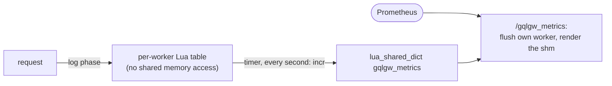

# Metrics

The admin server (`[metrics] port`, 8191 by default) exposes Prometheus metrics in the text
format on `[metrics] path` (`/gqlgw_metrics`). They are business metrics: operations, fields,
sources, cache levels.

```yaml title="prometheus.yml"
scrape_configs:
  - job_name: gqlgw
    metrics_path: /gqlgw_metrics
    static_configs:
      - targets: ["gateway:8191"]
```

## Families

| Metric | Type | Labels |
|---|---|---|
| `gqlgw_requests_total` | counter | `operation`, `type` (`query`, `mutation`, `unknown`), `result` (`ok`, `partial`, `request_error`, `http_error`) |
| `gqlgw_request_duration_seconds` | histogram | `operation` |
| `gqlgw_errors_total` | counter | `kind` (`document`, `operation`, `field`) |
| `gqlgw_field_requests_total` | counter | `coordinate` (`Type.field`) |
| `gqlgw_upstream_requests_total` | counter | `source`, `status` (`2xx`, `3xx`, `404`, `4xx`, `5xx`) |
| `gqlgw_upstream_duration_seconds` | histogram | `source` (time until the response headers) |
| `gqlgw_batches_total` | counter | `coordinate` |
| `gqlgw_batch_size` | histogram | `coordinate` (keys per batch request) |
| `gqlgw_cache_total` | counter | `source`, `level` (`l1`, `l2`, `l3`, `miss`) |
| `gqlgw_memcached_errors_total` | counter | — |
| `gqlgw_rounds` | histogram | — (rounds per request) |
| `gqlgw_doc_cache_total` | counter | `result` (`hit`, `miss`) |
| `gqlgw_info` | gauge | `version`, `schema_hash` |

`result` of a request: `ok` (no error), `partial` (field errors), `request_error` (the document or
the operation was rejected), `http_error` (refused by the HTTP layer).

### The `operation` label

| Value | When |
|---|---|
| the `operationName` that ran | named operations |
| `__anonymous` | no name |
| `__excluded` | the name matches a regex of `[metrics] exclude_operations` |
| `__unknown` | the request was refused before it was read |
| `__invalid` | the client's `operationName` is not a GraphQL name (rejected requests) |

There is no cap on this label: every operation name sent by clients creates series. If clients
send generated names, list them in `exclude_operations` (PCRE, checked by `openresty -t`).

`coordinate` is bounded by the schema, which makes `gqlgw_field_requests_total` the way to know
when a `@deprecated` field can go.

## Example

From the example gateway, after a few requests:

```text
gqlgw_requests_total{operation="__anonymous",type="query",result="ok"} 2
gqlgw_requests_total{operation="__anonymous",type="query",result="partial"} 2
gqlgw_requests_total{operation="__anonymous",type="unknown",result="request_error"} 2
gqlgw_batches_total{coordinate="Post.author"} 2
gqlgw_cache_total{source="users",level="l3"} 3
gqlgw_cache_total{source="users",level="miss"} 8
gqlgw_upstream_requests_total{source="posts",status="2xx"} 4
gqlgw_field_requests_total{coordinate="Post.author"} 3
gqlgw_info{version="0.2.0",schema_hash="dd5aa30cab392b8a"} 1
```

## Useful queries

```promql
# error ratio per operation
sum by (operation) (rate(gqlgw_requests_total{result=~"partial|request_error"}[5m]))
  / sum by (operation) (rate(gqlgw_requests_total[5m]))

# p95 latency per source
histogram_quantile(0.95, sum by (source, le) (rate(gqlgw_upstream_duration_seconds_bucket[5m])))

# cache hit ratio per source
sum by (source) (rate(gqlgw_cache_total{level!="miss"}[5m]))
  / sum by (source) (rate(gqlgw_cache_total[5m]))

# is anyone still using a deprecated field?
increase(gqlgw_field_requests_total{coordinate="User.email"}[30d]) > 0
```

## How they are collected



- Counters are aggregated per worker, then added to the shared dict by a one-second timer. A
  scrape can therefore miss up to one second of the other workers' data.
- Histograms are stored per bucket and made cumulative when rendered.
- The metrics cost nothing measurable on the [benchmark](../project/benchmarks.md) (within noise).
- Request metrics are recorded in the log phase: they need the `log_by_lua` generated by
  `gqlc render`.
- If the shared dict is full, increments are dropped with a warning: raise `[metrics] shm_size`.
