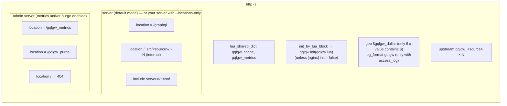

# Generated nginx configuration

`gqlc render` writes nginx configuration that you include, never a whole `nginx.conf`. Every name
it creates starts with `gqlgw_`, so it can live next to an existing configuration.



## Upstreams

```nginx
upstream gqlgw_users {
    zone gqlgw_users 64k;                       # shared state, needed by "resolve"
    resolver 10.53.0.1 valid=10s;               # [nginx] resolver, scoped to this upstream
    server users.internal:8080 resolve;         # re-resolved at runtime (DNS names only)
    keepalive 64;                               # [sources.users] keepalive
    keepalive_timeout 60s;
}
```

- One upstream per source, named `gqlgw_<source>`. An IP address gets a plain `server` line and no
  resolver.
- The resolver is declared **inside** the upstream, so it does not conflict with a resolver of
  your own configuration.

## The GraphQL location

```nginx
location = /graphql {
    set $gqlgw_path "";            # the upstream path, set by the Lua side per subrequest
    set $gqlgw_ctype "";           # Content-Type of subrequests with a body
    set $gql_rounds "-";           # filled by the log phase, used by log_format gqlgw
    set $gql_subrequests "-";
    set $gql_cache "-";
    client_max_body_size 1m;       # [gateway] max_body
    client_body_buffer_size 1m;    # keep request bodies in memory
    resolver 10.53.0.1 valid=10s;  # only when memcached is given by name
    access_log "/dev/stdout" gqlgw;    # only with [gateway] access_log
    content_by_lua_block { require("gqlgw").serve() }
    log_by_lua_block { require("gqlgw").log() }
}
```

The `set` lines declare the variables. The Lua side gives `$gqlgw_path` and `$gqlgw_ctype` a
value for each subrequest (the `vars` option of `ngx.location.capture_multi`), which the `/_src/`
locations then read.

## A source location

```nginx
location /_src/users/ {
    internal;
    proxy_http_version 1.1;
    proxy_set_header Connection "";
    proxy_set_header Host "users.internal:8080";
    proxy_set_header Accept-Encoding "";
    proxy_set_header Content-Type $gqlgw_ctype;
    proxy_pass_request_headers off;
    proxy_set_header Authorization $http_authorization;
    proxy_set_header Accept "application/json";
    more_set_headers "X-Gqlgw-Upstream-Time: $upstream_header_time";
    proxy_connect_timeout 1s;
    proxy_send_timeout 5s;
    proxy_read_timeout 2s;
    include "/etc/gqlgw/sources.d/users/*.conf";
    proxy_pass "http://gqlgw_users/api/v1$gqlgw_path";
}
```

| Directive | Why |
|---|---|
| `internal` | only subrequests reach it; `/_src/users/x` from a client is a `404` |
| `proxy_http_version 1.1`, `Connection ""` | keepalive connections to the upstream |
| `Host` | the host of the source URL (or `host_header`); otherwise nginx would send `gqlgw_users` |
| `Accept-Encoding ""` | subrequests inherit the client headers: the gateway must get plain JSON |
| `Content-Type $gqlgw_ctype` | `application/json` when the fetch has a body, nothing otherwise |
| `proxy_pass_request_headers off` + `proxy_set_header` | the allowlist (`forward_headers`) |
| `proxy_set_header X ""` | the denylist (`drop_headers`) |
| `Accept "application/json"` | unless `Accept` is forwarded or set |
| `more_set_headers X-Gqlgw-Upstream-Time` | upstream time for `gqlgw_upstream_duration_seconds` (only with metrics) |
| timeouts | `connect_timeout`, `send_timeout`, `read_timeout` of the source |
| `proxy_ssl_*` (https) | `proxy_ssl_verify on`, SNI with `proxy_ssl_name` (the URL host or `tls_name`), `proxy_ssl_trusted_certificate` (`ca`); or `proxy_ssl_verify off` with `tls_verify = false` |
| `include sources.d/<source>/*.conf` | your additions; an empty or missing directory is fine |
| `proxy_pass …<prefix>$gqlgw_path` | the source URL prefix, then the rendered path |

### Why `$gqlgw_path`

The path of a subrequest URI is decoded by nginx: `%2F` would become `/` and an argument could
change the path sent to the service. The gateway passes the rendered, already-encoded path in
`$gqlgw_path`, and `proxy_pass` sends it verbatim. On top of that, `strict_path_args` refuses `/`,
`\`, `.` and `..` as path segment values.

### Literal `$` in values

nginx interprets `$` in directive values. When a `set_headers` value contains one, the renderer
writes it as `${gqlgw_dollar}`, backed by `geo $gqlgw_dollar { default "$"; }`:
`X-Api-Key = "abc$def"` becomes `proxy_set_header X-Api-Key "abc${gqlgw_dollar}def";`.

## The admin server

```nginx
server {
    listen 8191;                   # [metrics] port
    access_log off;
    allow 10.0.0.0/8;              # [metrics] allow, then "deny all"
    deny all;
    location = /gqlgw_metrics { content_by_lua_block { require("gqlgw").metrics() } }
    location = /gqlgw_purge   { content_by_lua_block { require("gqlgw").purge() } }
    location / { return 404; }
}
```

It exists when metrics or purge are enabled. In `--locations-only` mode it stays in
`gqlgw.http.conf`.

## Extension points

| Directory (next to `gqlgw.toml`) | Included in | For |
|---|---|---|
| `server.d/*.conf` | the gateway `server {}` (default mode) | TLS certificates, extra locations, `limit_req` |
| `sources.d/<source>/*.conf` | `location /_src/<source>/` | client certificates, extra headers, buffers |
| `conf.d/*.conf` (Docker image only) | `http {}` | `map`, `limit_req_zone`, `log_format` |

In the Docker image, the directories are `/etc/gqlgw/server.d`, `/etc/gqlgw/sources.d` and
`/etc/gqlgw/conf.d`.

## No `lua_package_path`

The Lua modules are installed in OpenResty's `site/lualib`, which is already in its search path.
The generated files never set `lua_package_path`, so they do not override yours.
